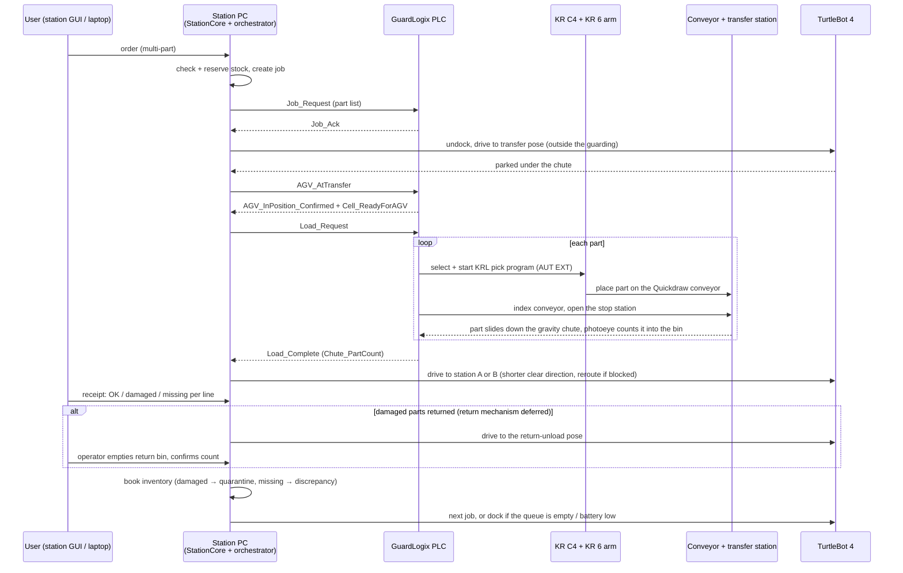

# APEx 2.0 — Automated Parts Exchange

**KUKA KR 6 R900-2 + Automation NTH FlexBase + TurtleBot 4**

APEx is an automated parts-delivery system for a small lab. A user orders
parts at the main station; a KUKA arm in a FlexBase cell picks each part and
puts it on a conveyor; a transfer station drops it into the bin of a
TurtleBot 4; the TurtleBot drives around a loop corridor to the requesting
workstation; the worker confirms every line as **OK**, **damaged** or
**missing**; and inventory, quarantine and discrepancies are updated at every
step. (Returning damaged parts to the FlexBase is **deferred** to a later
stage; the software already keeps a simple operator-emptied return trip.)

> **Status: Simulation Bring-up stage built, awaiting checkpoint review.**
> The ROS 2 workspace, the Gazebo model of the lab, the simulated FlexBase cell,
> the PLC bridge and the job orchestrator are in [`ros2_ws/`](ros2_ws/README.md).
> 53 tests and all headless demos pass; the Gazebo + Nav2 demos are ready to run on
> an Ubuntu 24.04 + ROS 2 Jazzy machine ([`docs/SIMULATION.md`](docs/SIMULATION.md)).
>
> Stages ([roadmap](docs/ROADMAP.md)): Audit & Architecture ✅ → **Simulation Bring-up** ✅ →
> Station HMI Upgrade → Learning-Based Navigation → Integration Documentation.

**Team decisions so far:** gravity chute from the FlexBase onto the TurtleBot ·
Ignition is the FlexBase HMI · damaged-part handling deferred · RL navigation
policy approved · the lab is modelled in Gazebo for the TurtleBot · no work over
spring break. Full list: [`docs/OPEN_QUESTIONS.md`](docs/OPEN_QUESTIONS.md#answered).

APEx 2.0 replaces the team's earlier custom AGV (Raspberry Pi 5 + Arduino +
RPLIDAR + Pi camera). That design, with its full git history, is preserved in
[`archive/old_agv/`](archive/) and was audited module by module in
[`docs/AUDIT.md`](docs/AUDIT.md). **Its requirements are void**; only ideas
that still fit (the inventory GUI, multi-part ordering, damaged/missing
receiving, and the network command interface) are carried over.

---

## Contents

1. [How a delivery works](#1-how-a-delivery-works)
2. [System architecture](#2-system-architecture)
3. [Hardware](#3-hardware)
4. [Safety principles](#4-safety-principles)
5. [Lab layout](#5-lab-layout)
6. [Networking](#6-networking)
7. [Repository layout](#7-repository-layout)
8. [Getting started](#8-getting-started)
9. [Documents](#9-documents)
10. [Open questions and decisions](#10-open-questions-and-decisions)

---

## 1. How a delivery works



The full state machine, with a timeout and a fault for every step, is in
[`docs/JOB_STATE_MACHINE.md`](docs/JOB_STATE_MACHINE.md).

## 2. System architecture

| Component | Runs on | Role |
|---|---|---|
| **Station GUI** (PySide6) + **StationCore** (SQLite) + **REST API** | Station PC | Inventory, multi-part orders, receiving, quarantine, job queue, robot status and a compact read-only cell summary; REST for the workstation laptop. Adapted from the old design. |
| **Ignition HMI** | Ignition gateway (lab network) | Operator HMI for the **FlexBase cell**: cell mode, conveyor, chute count, KUKA status, alarms, read-only safety status. Same handshake tags as the station software. |
| **`apex_orchestrator`** (ROS 2) | Station PC | Turns orders into jobs, runs the job state machine, loop routing, timeouts and faults. Talks to Nav2 on the robot and to the PLC bridge. |
| **`apex_plc_bridge`** (ROS 2, `pycomm3`) | Station PC | EtherNet/IP tag reads and **allow-listed non-safety writes** to the GuardLogix. Never touches safety tags. |
| **Compact GuardLogix 5380** | FlexBase | Owns the cell: conveyor, transfer station, KUKA program selection (AUT EXT over EtherNet/IP I/O), and in its **safety task** the PLd circuit and the KUKA safety interface (CIP Safety or X11). |
| **KR C4 compact + KR 6 R900-2** | FlexBase | Runs KRL pick programs started by the PLC. **Our Python code never commands the arm.** |
| **TurtleBot 4** | Mobile | Nav2 on a map of the lab (first generated from the Gazebo model, later a SLAM map), named poses from YAML, docking, battery reporting. An RL navigation policy is planned (Learning-Based Navigation stage). |
| **`apex_cell_sim`** | Station PC (simulation) | Imitates the PLC + KUKA + conveyor + transfer handshake with the **same tag names and timing**, so moving to hardware is a config change. |

Diagram and details: [`docs/ARCHITECTURE.md`](docs/ARCHITECTURE.md).

## 3. Hardware

| Item | Key facts | Source |
|---|---|---|
| **KUKA KR 6 R900-2** | 6 axes, 901 mm reach, 6.5 kg max payload (3 kg rated), ±0.02 mm repeatability, 208 × 208 mm footprint, ~55 kg | KUKA data sheet |
| **KR C4 compact** | Operating modes T1 (≤ 250 mm/s), T2, AUT, **AUT EXT** (PLC control). Safety via **X11** (discrete, dual-channel) **or** **X66** Ethernet safety (CIP Safety / PROFIsafe), never both. X66 = KLI to the plant network; X69 = KSI for the WorkVisual laptop. | KUKA KR C4 compact specification V10 |
| **Automation NTH FlexBase, 6 ft** | 72" × 40" (1.83 × 1.02 m), max height 7'6". Compact GuardLogix 5380, 1734 POINT I/O, PLd safety circuit, managed Ethernet switch, IFM IO-Link master, SMC EtherNet/IP valve bank, 3-segment stack light, optional Quickdraw conveyor with stop stations | FlexBase brochure |
| **TurtleBot 4 (standard)** | Create® 3 base, Raspberry Pi 4B, RPLIDAR A1M8, OAK-D Pro, display. 342 × 339 × 351 mm, 3.9 kg, **max payload 9 kg**, 0.31 m/s (safe mode), 2.5–4 h runtime. Top plate 270 × 250 mm acrylic, 4 × M4 | TurtleBot 4 user manual, hardware repo |
| **Transfer station** (to design) | **Gravity chute (transfer mode B, chosen):** stop station at the end of the conveyor, padded chute down into the TurtleBot's bin outside the guarding. Part-present photoeye counts every part. `transfer_mode` A (pusher) and C (tilt tray) stay configurable. | Project brief, team decision |

Manuals are kept locally (copyright); see [`docs/manuals/README.md`](docs/manuals/README.md).

## 4. Safety principles

These rules are **non-negotiable** and apply to every stage:

1. **Hands off safety.** Our software never writes, bypasses, simulates around or jumpers safety tags, safety I/O, CIP Safety bits or the PLd circuit. It only **reads** safety state for display.
2. **Arm and robot never overlap.** The TurtleBot stays **outside the FlexBase guarding** at all times; the arm moves only when the PLC says the cell is safe.
3. **Single point of control.** The PLC alone selects and starts KUKA programs (AUT EXT). Nothing writes safety-relevant KUKA signals, and `$OV_PRO` is never written in T1/T2. New KRL programs are tested in **T1** first.
4. **Operator safety restart** uses a manual acknowledge button **outside the guarding**; no auto-acknowledge.
5. **Faults stop everything.** Every job step has a timeout and a fault state; faults show in the GUI and need an operator reset; reset never restarts motion by itself.
6. **Risk assessment.** Every hazard found is flagged **⚠ RA** and listed in [`docs/RISK_ASSESSMENT_POINTS.md`](docs/RISK_ASSESSMENT_POINTS.md). As system integrator, **the team is responsible for the risk assessment** (KUKA specification, chapter 5).

## 5. Lab layout


The FlexBase sits in the middle of the lab, surrounded by a 5 ft loop
corridor. Two delivery stations face each other on opposite sides; the
transfer station, the return-unload pose and the charging dock are at the
conveyor end. Every number comes from one file,
[`ros2_ws/src/apex_bringup/config/lab.yaml`](ros2_ws/src/apex_bringup/config/lab.yaml),
which also generates the Gazebo worlds, the Nav2 map and this figure.
Everything here is a **proposal** to confirm against the real room:
[`docs/LAB_LAYOUT.md`](docs/LAB_LAYOUT.md).

## 6. Networking

- **ROS 2 discovery:** FastDDS **Discovery Server** on the TurtleBot's Raspberry Pi, with the Create® 3 Wi-Fi off, as the TurtleBot 4 manual recommends for university networks where multicast fails.
- **Now (school Wi-Fi):** only the TurtleBot uses it, for internet and updates. If enterprise authentication or client isolation blocks ROS traffic, the **fallback** is updates over school Wi-Fi and ROS traffic over our router.
- **Later (lab router):** an isolated network with a **controls VLAN** (PLC, KR C4 X66) that has **no route to the internet**, and a **robot VLAN** (TurtleBot, station PC).
- **The PLC and KR C4 are never put on the school network.** Config profiles: `network_school.yaml` and `network_lab.yaml`.

Details: [`docs/ARCHITECTURE.md` §7](docs/ARCHITECTURE.md#7-network).

## 7. Repository layout

```
apex-2.0/
├── README.md                    ← you are here
├── docs/
│   ├── ROADMAP.md               stages, calendar, Learning-Based Navigation plan
│   ├── SIMULATION.md            how to run tests, headless demos and Gazebo + Nav2 demos
│   ├── evidence/                recorded demo runs
│   ├── AUDIT.md                 Keep / Adapt / Retire audit of the old design
│   ├── ARCHITECTURE.md          components, KUKA control path, network, safety rules
│   ├── JOB_STATE_MACHINE.md     job states, timeouts, faults, routing, inventory booking
│   ├── LAB_LAYOUT.md            room layout, named poses, Gazebo model of the lab
│   ├── OPEN_QUESTIONS.md        everything still needed from the team
│   ├── RISK_ASSESSMENT_POINTS.md hazards to assess (⚠ RA)
│   ├── img/lab_layout.png       generated by tools/draw_lab_layout.py
│   └── manuals/README.md        which manuals go here (PDFs are git-ignored)
├── ros2_ws/                     ROS 2 Jazzy workspace (see ros2_ws/README.md)
│   ├── src/apex_interfaces/     messages + services
│   ├── src/apex_bringup/        lab.yaml, generated worlds + maps, configs, launch files
│   ├── src/apex_plc_bridge/     only connection to the PLC; write allow-list; network profiles
│   ├── src/apex_cell_sim/       simulated FlexBase cell (same tags as the real PLC)
│   ├── src/apex_orchestrator/   job state machine, loop router, Nav2 adapter, demos
│   ├── tests/                   pytest suite (no ROS needed)
│   └── requirements.txt
├── archive/
│   ├── README.md                why the old AGV was retired
│   └── old_agv/                 the old design with its git history (reference only)
├── tools/
│   ├── fetch_third_party.sh     clones the TurtleBot reference repos (jazzy)
│   └── draw_lab_layout.py       regenerates the layout figure from lab.yaml
└── third_party/                 (git-ignored) TurtleBot reference repos
```

Coming in **Station HMI Upgrade**: `station/` (adapted GUI, StationCore,
REST API).

## 8. Getting started

**Any computer (no ROS):** tests and headless demos.

```bash
git clone https://github.com/CDJ7/apex-2.0.git
cd apex-2.0
python3 -m pip install pyyaml pytest
python3 -m pytest ros2_ws -q                                        # all tests
cd ros2_ws && PYTHONPATH=$(ls -d src/apex_* | tr '\n' ':') python3 -m apex_orchestrator.demo all
```

**Ubuntu 24.04 + ROS 2 Jazzy + Gazebo Harmonic:** the full simulation.

```bash
sudo apt install ros-jazzy-turtlebot4-simulator ros-jazzy-irobot-create-nodes ros-jazzy-turtlebot4-navigation
source /opt/ros/jazzy/setup.bash
cd apex-2.0/ros2_ws && rosdep install --from-paths src --ignore-src -y
colcon build --symlink-install && source install/setup.bash
ros2 launch apex_bringup demo.launch.py scenario:=full       # (a) full order
ros2 launch apex_bringup demo.launch.py scenario:=reroute    # (b) blocked corridor -> reroute
ros2 launch apex_bringup demo.launch.py scenario:=return     # (c) damaged-part return
```

Step-by-step instructions, expected output and troubleshooting:
[`docs/SIMULATION.md`](docs/SIMULATION.md).

**Reference material:**

```bash
tools/fetch_third_party.sh          # TurtleBot reference repos → third_party/ (jazzy)
# put the manuals into docs/manuals/ (see docs/manuals/README.md)
python3 tools/draw_lab_layout.py    # needs matplotlib; regenerates docs/img/lab_layout.png from lab.yaml
```

## 9. Documents

| Document | What's in it |
|---|---|
| [ROADMAP](docs/ROADMAP.md) | The stages, what each delivers, the calendar, the Learning-Based Navigation plan |
| [SIMULATION](docs/SIMULATION.md) | Running the tests, headless demos and Gazebo + Nav2 demos; how the simulation is built; what still needs testing |
| [ros2_ws README](ros2_ws/README.md) | The ROS 2 packages, each with its own detailed README |
| [AUDIT](docs/AUDIT.md) | Every old module classified Keep / Adapt / Retire, with reasons |
| [ARCHITECTURE](docs/ARCHITECTURE.md) | Block diagram; GUI, orchestrator, PLC bridge, KUKA path (AUT EXT, CIP Safety vs X11, SPOC), TurtleBot, transfer station; ROS packages; data ownership; network; safety rules |
| [JOB_STATE_MACHINE](docs/JOB_STATE_MACHINE.md) | Pickup → delivery → return → finish; timeout and fault for every step; loop routing; inventory booking |
| [LAB_LAYOUT](docs/LAB_LAYOUT.md) | Map frame, FlexBase footprint, corridors, named poses, routing waypoints, obstacle demo positions, the Gazebo model of the lab |
| [OPEN_QUESTIONS](docs/OPEN_QUESTIONS.md) | What we still need from the team, with current assumptions |
| [RISK_ASSESSMENT_POINTS](docs/RISK_ASSESSMENT_POINTS.md) | Hazards the team must assess before running |

## 10. Open questions and decisions

Current working assumptions, each listed in
[`docs/OPEN_QUESTIONS.md`](docs/OPEN_QUESTIONS.md) for confirmation:
- ROS 2 **Jazzy** on the TurtleBot.
- **Ubuntu 24.04** station PC, with a Windows laptop for Studio 5000 and WorkVisual.
- Parts ride **directly on the conveyor belt** so they can run off the end into the gravity chute.
- **Ignition** gateway on the lab network, with its own request bits (one writer per bit).
- The **RL policy** controls local driving only; routing stays rule-based.
- **CIP Safety** to the KUKA if the option is installed, otherwise X11.
- One TurtleBot.
