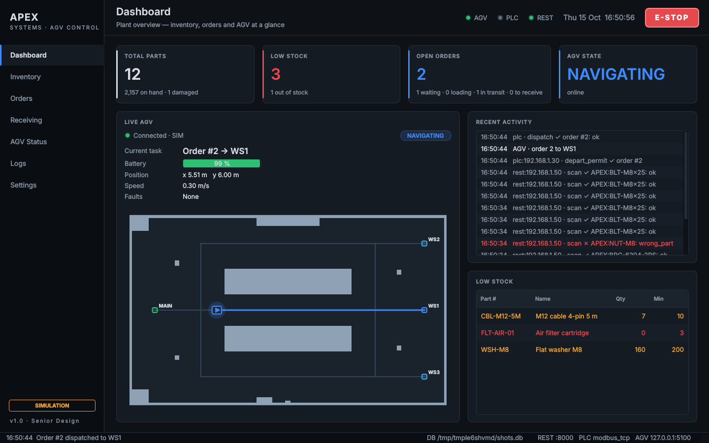
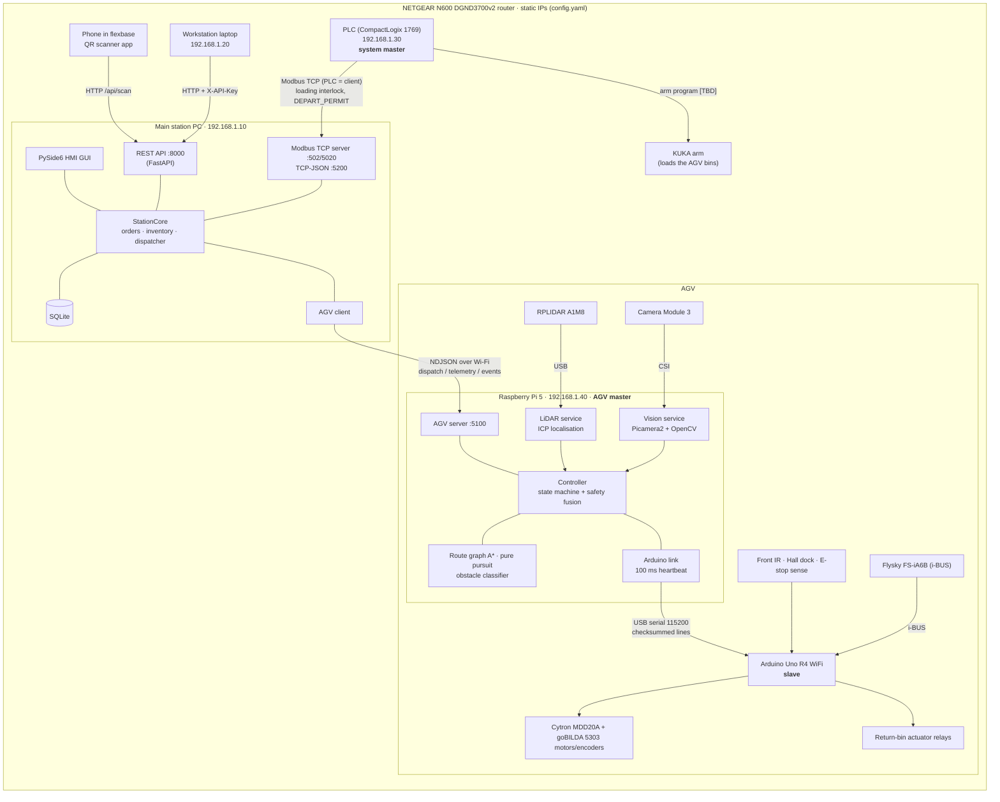
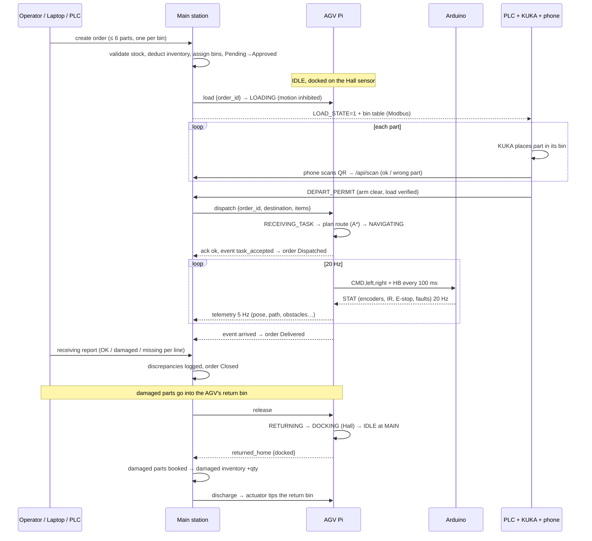
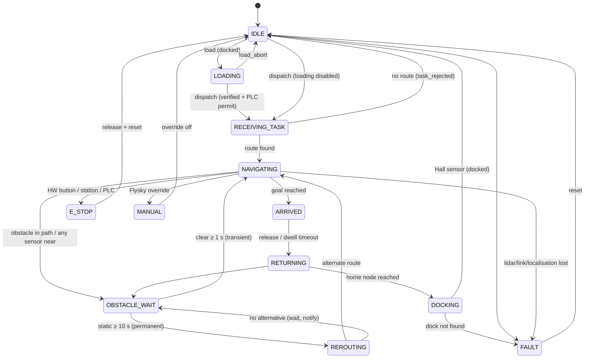
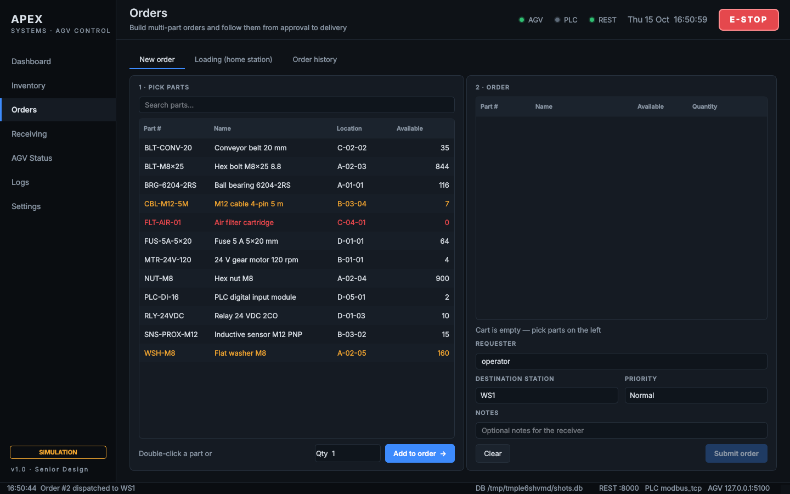
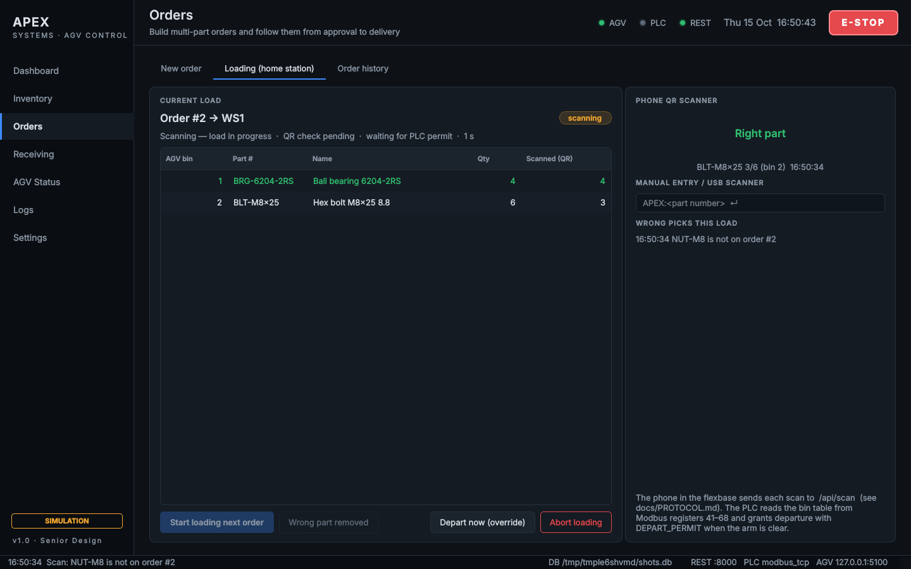
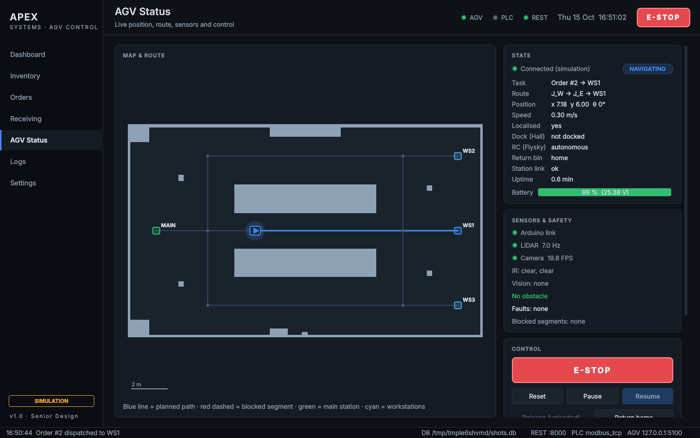
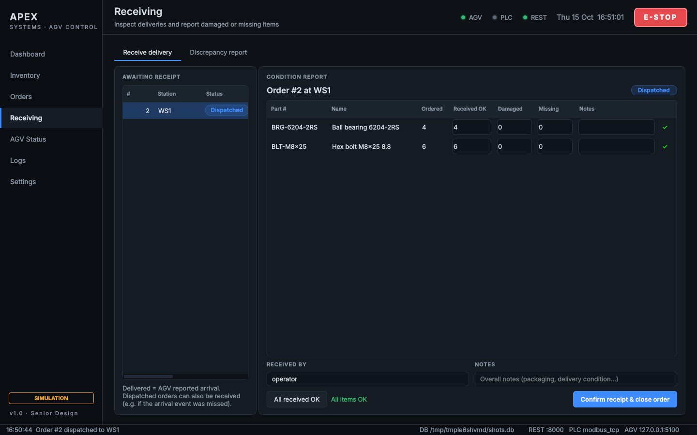
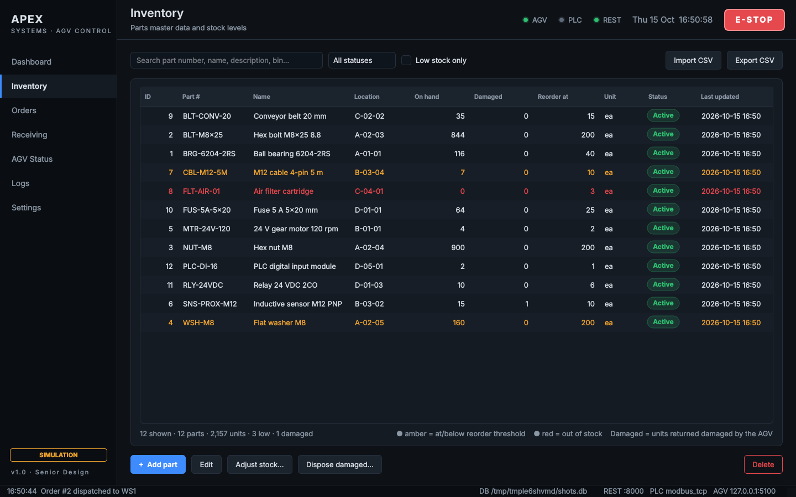

# APEX Systems — Automated Guided Vehicle (AGV)

Software for a senior-design AGV that delivers parts from a **home (main)
station**, where a KUKA arm loads its six bins, to workstations — and brings
damaged parts back in its return bin. It contains four programs that talk
over one local router (NETGEAR N600 DGND3700v2):

| # | Component | Runs on | Folder |
|---|---|---|---|
| 1 | **Main station GUI + servers** — inventory (incl. damaged stock), multi-part orders (≤ 6 parts, one per bin), home-station loading with phone QR verification and PLC departure permit, receiving/condition reports, damaged returns, AGV monitor & control, REST API (laptop, phone), Modbus TCP / TCP-JSON (PLC) | Station PC `192.168.1.10` | [`station_gui/`](station_gui) |
| 2 | **LiDAR mapping & navigation** — RPLIDAR A1M8 driver, ICP mapping/localisation, route graph, A* planning, obstacle classification & rerouting | Raspberry Pi 5 `192.168.1.40` | [`agv_pi/lidar/`](agv_pi/lidar) |
| 3 | **Main AGV controller** — state machine (loading, Hall docking, manual RC, link hold), LiDAR+camera+IR safety fusion, computer vision (Picamera2 + OpenCV), Wi-Fi interface, Arduino link | Raspberry Pi 5 | [`agv_pi/`](agv_pi) |
| 4 | **Low-level firmware** — Cytron MDD20A motors with ramping, goBILDA encoders, front IR, Hall dock sensor, return-bin actuator relays, Flysky i-BUS manual override, E-stop sense, watchdog | Arduino Uno R4 WiFi | [`agv_arduino/`](agv_arduino) |

Everything runs in **simulation on a laptop** (simulated Arduino firmware,
LiDAR, camera, PLC, KUKA arm + QR phone, and laptop clients), so the whole
system can be demoed and tested without hardware.



---

## System architecture



**Hierarchy** (respected everywhere): the **PLC** is the top-level master (it
initiates every Modbus transaction and can create orders, E-stop, reset,
release…). On the AGV the **Pi** is the master and makes every decision; the
**Arduino** is a slave that only executes motor/actuator commands and reports
sensor data — its only autonomous actions are safety reflexes (E-stop sense,
500 ms command watchdog) and driving from the Flysky sticks while the RC
override switch is on. The real emergency stop is the **hardwired E-stop that
drops contactor K1** (motion power); see [`docs/WIRING.md`](docs/WIRING.md).

### How a delivery flows



### AGV state machine



(Every state can enter FAULT / E_STOP / MANUAL; after a reset during a task
the leg is resumed **paused** and needs an explicit *resume*. If the station
link is silent for 3 s while moving, the AGV holds still until it returns.)

---

## Repository layout

```
apex-agv/
├── README.md               ← you are here
├── config.yaml             ← ALL IPs, ports, devices, geometry, tuning (never hard-coded)
├── requirements-dev.txt    ← everything for laptop simulation + tests
├── common/                 ← shared by every component
│   ├── config.py               config loader (+ env overrides, sim → 127.0.0.1)
│   ├── logging_setup.py        structured key=value logging, rotating files
│   ├── netlink.py              NDJSON framing, reconnecting client
│   └── protocol/
│       ├── serial_protocol.py  Pi ↔ Arduino frames + checksums
│       ├── messages.py         station ↔ AGV message schema
│       ├── modbus_map.py       PLC register map + command codes
│       └── states.py           AGV states, order statuses, fault codes
├── station_gui/            ← FILE 1: main station
│   ├── app.py                  GUI entry point          server_main.py  headless entry point
│   ├── core/                   database, inventory, orders, loading (KUKA + QR), StationCore, AGV link, event bus
│   ├── net/                    REST API, Modbus TCP server + bridge, TCP-JSON server
│   └── ui/                     theme (QSS), widgets, map view, pages/*
├── agv_pi/                 ← FILES 2 & 3: Raspberry Pi 5
│   ├── main.py                 AGV master process (systemd service)
│   ├── controller/             state machine, safety fusion, AgvController
│   ├── lidar/                  RPLIDAR driver, ICP, mapping, localisation, routes, planners,
│   │                           obstacle monitor, mapping_tool.py, route_editor.py
│   ├── vision/                 Picamera2 camera, motion detector, person detector, service
│   ├── sensors/ir.py           IR processing (Arduino-forwarded, optional Pi GPIO)
│   ├── hardware/               Arduino serial link, odometry, wheel speed control
│   ├── comms/agv_server.py     Wi-Fi command/telemetry server
│   ├── sim/                    simulated world, firmware, LiDAR, camera, map generator
│   ├── tools/                  arduino_console, lidar_check, camera_check
│   ├── maps/                   occupancy maps (PNG+YAML) and route graphs
│   ├── systemd/  udev/  models/
│   └── requirements.txt  requirements-sim.txt
├── agv_arduino/            ← FILE 4: Uno R4 WiFi sketch (agv_arduino.ino)
├── docs/
│   ├── PROTOCOL.md             every protocol, field by field
│   ├── PI_SETUP.md             blank SD card → running service
│   ├── WIRING.md               pin table, driver variants, power, E-stop
│   ├── PLC_INTEGRATION.md      CompactLogix (Modbus TCP Client AOI) setup, loading interlock
│   ├── code_vs_report_gaps.md  midterm report ↔ code reconciliation (G-01…G-33)
│   ├── project_facts.md        facts extracted from the midterm report
│   ├── BRINGUP.md              calibration + "verify on real hardware" checklist
│   └── img/                    GUI screenshots
└── tests/                  ← simulators, fake clients, unit + integration tests
    ├── fake_plc.py             PLC via pymodbus (or TCP-JSON)
    ├── fake_station_cell.py    PLC + KUKA arm + phone QR scanner (loading sequence)
    ├── fake_laptop_client.py   REST client
    ├── sim_scenarios.py        delivery+docking / discharge / person / block / dead-end / E-stop /
    │                           manual RC / link-loss acceptance runs
    ├── run_demo.py             AGV sim + station (+ --cell) in one command
    ├── gui_screenshots.py      renders every GUI page to PNG
    └── test_*.py               pytest suites (42 tests)
```

---

## Quick start — full simulation on a laptop

Python **3.10+** (tested with 3.13). From the `apex-agv/` folder:

```bash
python -m venv .venv && source .venv/bin/activate      # Windows: .venv\Scripts\activate
pip install -r requirements-dev.txt

python -m tests.run_demo --cell             # AGV simulator + station GUI + simulated KUKA/phone/PLC
```

or start the parts separately (each in its own terminal):

```bash
python -m agv_pi.main --sim                 # the AGV (simulated Arduino, LiDAR, camera, world)
python -m station_gui.app --sim             # the station GUI (REST :8000, Modbus :5020, AGV link)
python -m tests.fake_laptop_client --sim order WS1 BRG-6204-2RS:2 BLT-M8x25:10
python -m tests.fake_plc --sim monitor      # PLC view of the registers (Ctrl+C to stop)
python -m tests.fake_plc --sim order --part 3 --qty 5 --station 4
python -m tests.fake_station_cell --sim --wrong-pick 1   # KUKA + phone + PLC permit
```

In the GUI: **Orders → New order** to build a cart (max 6 parts) and submit;
**Orders → Loading** shows the KUKA/QR progress (without the cell simulator,
type `APEX:<part number>` into the scan box and use *Depart now*); watch the
AGV drive on **AGV Status**; on **Receiving** report OK / damaged / missing
per line — damaged units come back with the AGV and appear in the
**Inventory → Damaged** column. In simulation the AGV Status page has a *Simulation* panel: choose
"Place box" or "Place person" and **click on the map** to drop an obstacle in
the AGV's path (a box blocks a segment and triggers a reroute after 10 s; a
person makes it wait).

Scripted acceptance scenarios (station not running, or auto-dispatch off):

```bash
python -m tests.sim_scenarios all           # deliver, discharge, person, block, deadend, estop,
                                            # manual, link → PASS/FAIL
```

Unit/integration tests:

```bash
python -m pytest tests                      # 42 tests, ~7 s (GUI test runs headless/offscreen)
```

## Running on the real hardware

1. **Arduino**: wire per [`docs/WIRING.md`](docs/WIRING.md), set polarity and
   options in the sketch, upload ([`agv_arduino/README.md`](agv_arduino/README.md)).
2. **Raspberry Pi 5**: follow [`docs/PI_SETUP.md`](docs/PI_SETUP.md) (OS, static IP,
   camera, venv, udev, smoke tests, mapping, systemd).
3. **Main station PC**: `pip install -r station_gui/requirements.txt`, set IPs and
   secrets in `config.yaml`, then `python -m station_gui.app`.
4. **PLC**: configure the Modbus TCP Client AOI per [`docs/PLC_INTEGRATION.md`](docs/PLC_INTEGRATION.md).
5. **Phone**: point the QR scanner app at `/api/scan` ([`docs/PROTOCOL.md` §5.1](docs/PROTOCOL.md#51-phone-qr-scanner-home-station-loading)).
6. **Calibrate and verify** with [`docs/BRINGUP.md`](docs/BRINGUP.md).

The AGV must be powered on **docked at the home station (MAIN)** facing the
home heading — that is its initial localisation (or send `set_pose`).

---

## Engineering decisions (and why)

| Topic | Decision | Rationale |
|---|---|---|
| Pi ↔ Arduino | **USB serial**, ASCII lines with XOR checksum, 100 ms heartbeat, 500 ms Arduino watchdog | Avoids the R4 (5 V) ↔ Pi (3.3 V) logic-level problem; human-readable for bench debugging; any lost link stops the motors. |
| Low-level controller | **Arduino Uno R4 WiFi kept** (the midterm report wires the MDD20A and encoders to Pi GPIO) | Team decision: the Arduino keeps real-time I/O, the watchdog and the RC override independent of the Pi's Linux scheduling. |
| Arduino role | executes PWM, reports `STAT` at 20 Hz; only safety reflexes + RC manual mode are local | Matches the required hierarchy; motors stop even if the Pi hangs. Wheel-speed PI control runs on the Pi using the reported encoder speeds. |
| Motor driver | **Cytron MDD20A** in PWM/DIR mode | Report BOM; 20 A continuous per channel covers the goBILDA 5303's 11 A at rated torque. |
| IR sensors | **2 sensors in front of the drive wheels, wired to the Arduino** (analog or digital) | Catch low objects the camera misses; Pi 5 has no ADC. Model still TBD. |
| Load verification | **phone QR scanner in the flexbase → `/api/scan`**, ≤ 6 parts per order (one per bin) | Team decision: keeps the KUKA cell simple and makes wrong picks detectable; the Pi camera stays a forward obstacle detector. |
| Departure | AGV leaves only when **docked (Hall)**, load **verified** and the **PLC grants DEPART_PERMIT** | Report control logic: the PLC interlocks loading and grants departure. |
| PLC protocol | **Modbus TCP, station = server, PLC = client** (port 502); TCP-JSON fallback | CompactLogix + Rockwell's Modbus TCP Client AOI; keeps the PLC as the initiator/master. |
| Modbus server | small built-in implementation (FC 3/4/6/16), `pymodbus` used as the test client | pymodbus' *server* datastore API changed several times in 3.x and is being replaced for 4.0; the built-in server keeps the register map stable and hooks writes directly. |
| Station ↔ AGV | NDJSON over TCP, AGV is the server, token handshake | Simple, debuggable (`nc`), push telemetry/events, works for multiple clients (station + tools). |
| LiDAR driver | own RPLIDAR A1 protocol implementation | Full control of health/reset/resync/reconnect; no unmaintained dependency. |
| SLAM | odometry-seeded **point-to-line ICP** against the map built so far + log-odds grid | Lightweight enough for the Pi 5 in pure NumPy/SciPy; point-to-line converges fast in corridors. |
| Planning | **A\* on a route graph** (stations/waypoints) + grid A\* to join the graph; pure pursuit | Predictable, operator-defined lanes; blocked segments are simply removed from the graph to find the alternate route. |
| Obstacles | only points *not explained by the map* in the path corridor; centroid tracking + camera motion → transient vs permanent | Walls never trigger stops; a person walking (moving) never causes a reroute; a static object > 10 s does. |
| Vision | MOG2 when stationary, **ego-motion-compensated differencing** (LK flow + RANSAC homography) when moving; optional MobileNet-SSD | Background subtraction alone fails on a moving robot; ~50 FPS at 320×240 on a laptop, well above the 15 FPS target on a Pi 5. |
| Station threading | uvicorn thread, asyncio thread for PLC servers, AGV client thread; event bus → Qt queued signals | The GUI never blocks on the network. |
| Persistence | SQLite (WAL) with a full audit log incl. source IP | Zero-admin, single file, safe concurrent reads. |
| Security | REST API key, AGV/PLC tokens, optional IP allow-lists, pydantic validation, every remote command logged with source IP | Appropriate for an isolated plant LAN; secrets can come from env vars. |

Still to confirm (marked `[TBD]` in `config.yaml` and the docs; full list in
[`docs/code_vs_report_gaps.md`](docs/code_vs_report_gaps.md)): CompactLogix
controller catalog number, IR sensor model, Hall sensor and actuator models,
encoder supply voltage, track width / overall width, battery voltage
thresholds, actuator timings, router subnet, QR scanner app, KUKA ↔ PLC
interface, and measured stopping distance.

## Configuration

All settings live in [`config.yaml`](config.yaml) (commented). Override
secrets with environment variables `APEX_API_KEY`, `APEX_AGV_TOKEN`,
`APEX_PLC_TOKEN`; force simulation with `--sim` or `APEX_SIM=1`. In
simulation every host becomes `127.0.0.1`.

## Screenshots

| | |
|---|---|
|  |  |
|  | |
|  |  |
