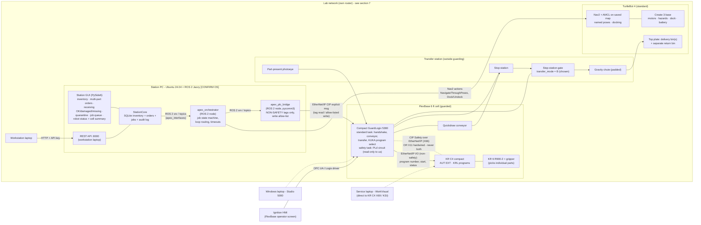

# APEx 2.0 — System architecture

**Stage:** Audit & Architecture. This is the design the later stages build;
anything marked **[TBD]** or **[CONFIRM]** is listed in
[`OPEN_QUESTIONS.md`](OPEN_QUESTIONS.md). Places that need the team's formal
risk assessment are marked **⚠ RA** and collected in
[`RISK_ASSESSMENT_POINTS.md`](RISK_ASSESSMENT_POINTS.md).

## 1. What the system does

A user orders parts at the **main station** (or from the workstation laptop).
The **KUKA KR 6 R900-2** inside the **FlexBase** cell picks each ordered part
individually and places it on the **Quickdraw conveyor**. The conveyor carries
it out of the guarded cell to a **transfer station**, where a transfer
mechanism drops it through a padded **chute** into the delivery bin of a
**TurtleBot 4** parked underneath. A photoeye counts every part that lands.
The TurtleBot drives around the loop corridor to one of two **delivery
stations**, the worker confirms each line as OK / damaged / missing, puts
damaged parts in the separate **return bin**, and the TurtleBot brings them
back to the FlexBase, where an operator empties the return bin and confirms
the count. Inventory, quarantine (damaged) and discrepancies (missing, not
loaded) are updated at every step.

**The TurtleBot never enters the FlexBase guarding**, and the arm's danger
zone and the robot's path never overlap.

## 2. Block diagram

Solid lines are runtime data paths; dashed lines are safety or service
connections. **Our Python code never commands the arm directly. It asks the
PLC, and the PLC decides.**

## 3. Components

### 3.1 Station GUI (PySide6) and StationCore

Carried over from the old design (see [`AUDIT.md`](AUDIT.md)) and rebuilt in
the **Station HMI Upgrade** stage: [`station/README.md`](../station/README.md).
StationCore talks to the orchestrator through a `JobLink` - the ROS 2 client
(`--link ros`) or a built-in simulation that runs the real job machine and
cell simulator in-process, so the HMI works on any computer.

**Split of screens (team decision):** **Ignition** is the HMI for the FlexBase
cell (§3.1a). The station GUI is the HMI for **orders, inventory and the
TurtleBot**. It shows only a small read-only cell summary (link, mode, fault,
"SIMULATED SAFETY" banner) taken from `/apex/cell_status`, so operators do not
get two competing cell screens.

- **Inventory**: parts, on-hand, reorder thresholds, CSV import/export,
  audited adjustments. Damaged parts go to a **quarantine** count; they are
  never restocked automatically.
- **Multi-part ordering**: cart → stock check and reservation → job.
- **Receiving**: per line OK / damaged / missing (must sum to the delivered
  quantity), discrepancy report.
- **Status panels** (new): live map with TurtleBot pose, battery, dock state,
  current job, route direction and bin count; a compact **read-only** cell
  summary (PLC link, cell mode, fault text, KUKA ready); job queue; quarantine
  view. Full cell / KUKA / safety screens live in Ignition.
- **REST API** for the workstation laptop (kept).
- `StationCore` **owns the SQLite database**. The orchestrator reports job
  events; `StationCore` books them into inventory, so there is one writer.

### 3.1a FlexBase HMI: Ignition

- Ignition (Inductive Automation) is the operator HMI for the cell: cell mode,
  conveyor, stop station, chute count, KUKA mode/ready/busy/fault/program,
  stack light, alarms, and the **read-only** safety status the PLC exposes.
- It connects to the Compact GuardLogix with Ignition's Allen-Bradley Logix
  driver (or OPC UA) on the **lab network only**.
- Ignition screens use the **same `APEX_ToStation` / `APEX_FromStation` tags**
  as the station software (`ros2_ws/src/apex_bringup/config/plc_tags.yaml`), so
  there is one tag contract. Any Ignition button that requests an action
  (start cycle, reset) writes a **standard-task request bit** and the PLC
  decides; Ignition, like our Python code, never writes safety tags. Safety
  resets stay on the hardwired acknowledge button outside the guarding. **⚠ RA**
- Who owns which request bits (Ignition vs station) is defined in
  `PLC_INTEGRATION.md` (Integration Documentation stage) to avoid two writers
  for the same bit.

### 3.2 `apex_orchestrator` (ROS 2 node on the station PC)

Turns orders into **jobs** and runs the job state machine
([`JOB_STATE_MACHINE.md`](JOB_STATE_MACHINE.md)):

- One job at a time in v1 (single TurtleBot, single transfer station); others wait in a FIFO queue.
- Talks to Nav2 through the `turtlebot4_navigation` `TurtleBot4Navigator`
  API (wraps Nav2's `BasicNavigator`): `undock()`, `dock()`,
  `startToPose()` / `startThroughPoses()`, `getDockedStatus()`.
- **Loop routing**: for each trip it builds the clockwise and
  counter-clockwise waypoint lists from the corridor corners in YAML, takes
  the shorter direction that is not marked blocked, and on failure (Nav2
  task failed, progress timeout, or the path blocked for longer than
  `blocked_timeout_s`) marks that direction blocked for a while and re-sends
  the job the other way round. Nav2 still does local obstacle avoidance
  inside the corridor.
- **Precise parking at the transfer station**: normal Nav2 goal tolerance
  (`xy_goal_tolerance: 0.25` m in `turtlebot4_navigation/config/nav2.yaml`)
  is far too loose for a chute. Plan: Nav2 brings the robot to a staging
  pose, then a final approach with Nav2's `opennav_docking` using a
  non-charging dock plugin (`SimpleNonChargingDock`; **[VERIFY]** it is in
  the Nav2 Jazzy release on our robot) and a fiducial (e.g. an AprilTag seen
  by the OAK-D Pro) at the transfer station. The `turtlebot4_navigation`
  Jazzy `nav2.yaml` already configures `opennav_docking` with
  `docking_threshold: 0.05`. Fallback: Nav2 goal with tightened goal
  tolerances, then a short creep. Achievable accuracy must be **measured**;
  the funnel is sized to it (`docs/TRANSFER_STATION.md`, Integration
  Documentation stage).
- **Every step has a timeout and a fault state**; faults stop the sequence,
  cancel Nav2 goals, tell the PLC (`Job_Fault`), show in the GUI and need an
  operator reset.
- Battery: subscribes to `/battery_state`; docks when the queue is empty or
  the charge is below `battery_dock_pct` **[TBD]**, and will not start a job
  below `battery_min_start_pct` **[TBD]**.

### 3.3 `apex_plc_bridge` (ROS 2 node, `pycomm3`)

- Connects to the GuardLogix with `pycomm3.LogixDriver` (EtherNet/IP CIP
  explicit messaging).
- **Reads** status tags, including safety *status* tags, which are only
  displayed.
- **Writes** only the members of one standard-task handshake UDT
  (e.g. `APEX_FromStation`), enforced by a hard-coded allow-list. Any write
  to another tag, a safety-task tag, a safety I/O point or a KUKA
  Ethernet-safety bit is refused in code and logged. The PLC program
  additionally ignores station writes unless the cell is in AUT EXT and
  healthy.
- Heartbeats in both directions; a stale heartbeat is a fault on both sides.
- In simulation, the same node points at `apex_cell_sim` instead of a real
  PLC. Same tag names, same handshake, same timing: switching to hardware is
  a config change.

**Preliminary non-safety handshake tags.** Final list, data types and
routines come in the Integration Documentation stage
(`docs/PLC_INTEGRATION.md`).

| Direction | Tag | Meaning |
|---|---|---|
| Station → PLC | `Station_Heartbeat` | toggles every 500 ms |
| Station → PLC | `Job_ID`, `Job_Request` | new job (order) |
| Station → PLC | `Job_PartCodes[]`, `Job_PartQty[]`, `Job_LineCount` | parts to pick (codes map to taught pick positions) |
| Station → PLC | `AGV_AtTransfer` | TurtleBot reports it is parked at the transfer pose |
| Station → PLC | `Load_Request` | start loading the parts for `Job_ID` |
| Station → PLC | `Return_Request` | TurtleBot is at the return-unload pose (operator task) |
| Station → PLC | `Job_Cancel`, `Fault_Reset_Request` | operator actions from the GUI (PLC decides) |
| PLC → Station | `PLC_Heartbeat`, `Cell_Mode` | heartbeat; cell AUTO / MANUAL / FAULT |
| PLC → Station | `Job_Ack` | job accepted (echoes `Job_ID`) |
| PLC → Station | `Cell_ReadyForAGV` | transfer station clear and ready for a robot |
| PLC → Station | `AGV_InPosition_Confirmed` | PLC confirms the robot is in position (photoeye under chute) |
| PLC → Station | `Conveyor_Run`, `StopStation_Release`, `Pusher_Extend` | conveyor and transfer state (read-only to us) |
| PLC → Station | `Chute_PartCount` | parts counted by the photoeye for this job |
| PLC → Station | `Transfer_Complete`, `Transfer_Fault` | per-part transfer result |
| PLC → Station | `Load_Complete` | all parts of the job transferred |
| PLC → Station | `Job_Fault`, `Fault_Code` | cell fault (timeout, count mismatch, pick failure, ...) |
| PLC → Station (read-only) | `KUKA_Mode`, `KUKA_Ready`, `KUKA_Busy`, `KUKA_Fault`, `KUKA_ProgramNo` | arm status for the GUI |
| PLC → Station (read-only) | `Safety_*` status, `StackLight_*` | safety state and stack-light mirror (display only) |

### 3.4 KUKA control path

**The PLC is the only thing that tells the arm what to do.**

1. KR C4 in **AUT EXT**. Programs are selected and started by the PLC through
   the KUKA Automatic External interface: the standard `CELL.SRC` program-number
   handshake (`PGNO` bits, `PGNO_VALID`, `$EXT_START`, `$MOVE_ENABLE`,
   `$DRIVES_ON` / `$DRIVES_OFF`, `$CONF_MESS`; robot outputs `$PERI_RDY`,
   `$STOPMESS`, `$PRO_ACT`, `PGNO_REQ`, `APPL_RUN`, `$IN_HOME`).
   These signal names come from the KUKA System Software (KSS) operating
   instructions for system integrators, which are **not** in our manuals
   folder **[CONFIRM against the KSS version on our controller]**.
2. Transport: **EtherNet/IP I/O** between the GuardLogix and the KR C4 over
   **X66 (KUKA Line Interface, KLI)**. This needs the KUKA.EtherNet/IP option
   on the controller **[CONFIRM installed]**, configured in WorkVisual over
   **X69 (KSI)** from a service laptop.
3. One KRL program per action, e.g. `PICK_PART(part_code)` places one part on
   the conveyor and returns home. Pick positions are taught on the smartPAD
   in **T1**. New or modified programs are always tested in **T1 (≤ 250 mm/s,
   velocity-monitored by the safety controller)** before AUT EXT.
4. **Single point of control** (manual §5.8.9): the PLC and every remote tool
   must not write safety-relevant signals or variables (operating mode,
   E-STOP, safety gate), and must **never write `$OV_PRO` in T1 or T2**. The
   PLC program gates any override writes on the AUT EXT status bit, and our
   Python code never writes KUKA signals at all.

**Safety interface: X11 or X66 Ethernet safety, never both.**

- **Recommended:** **CIP Safety over EtherNet/IP** between the Compact
  GuardLogix and the KR C4, if the controller has the Ethernet safety option
  **[CONFIRM]**. It uses the manual's Ethernet safety bits:
  - **Inputs to the KR C4:** `NHE` external E-STOP, `BS` operator safety,
    `QBS` operator-safety acknowledge, `SHS1` / `SHS2` safety stop 1/2,
    `US2`, `SBH` safe operational stop, `SPA`. **Reserved inputs set to 1**,
    as KUKA recommends.
  - **Outputs from the KR C4:** `NHL`, `AF`, `FF`, `ZS`, `PE`, `AUT`, `T1`,
    `T2`, `NHE`, `BSQ`, `SHS1`, `SHS2`, `PSA`, `SP`.
- **Otherwise:** X11 hardwired, dual-channel, to GuardLogix safety I/O
  (external E-STOP, operator safety, acknowledge, safe operational stop,
  safety stop 2, external enabling).
- Either way, all of this lives in the PLC **safety task** and the KR C4
  safety configuration. **Our software only reads status.**
- Operator safety: restart after a safeguard opens needs a **manual
  acknowledge button outside the guarding** (manual §5.5.4 and §5.6.7).
  Auto-acknowledge on gate close is not permitted. **⚠ RA**
- With the Ethernet safety interface, switching the KR C4 off does **not**
  E-STOP the overall system (manual §5.5.6). The risk assessment must
  consider this. **⚠ RA**

**Future options only** (not planned, each needs a paid KUKA option):

| Option | What it gives | Requires |
|---|---|---|
| KUKA.EthernetKRL (EKI) | XML/TCP data exchange between KRL and a PC, e.g. pick coordinates from vision | KUKA.EthernetKRL software option licence |
| KUKA.RobotSensorInterface (RSI) + [`kroshu/kuka_drivers`](https://github.com/kroshu/kuka_drivers) | ROS 2 `ros2_control` real-time motion streaming | KUKA.RSI option licence; KSS version supported by the driver; real-time network; a much larger safety and risk-assessment effort |

Both would make a PC a motion source. That breaks the *PLC is the single
point of control* principle and needs its own risk assessment. **⚠ RA**

### 3.5 TurtleBot 4 (standard)

- Create® 3 base, Raspberry Pi 4B 4 GB, RPLIDAR A1M8, OAK-D Pro, UI board.
  342 × 339 × 351 mm, 3.945 kg.
- **Maximum payload 9 kg** (user manual, *Features*); bins, fixture and parts
  must stay well inside it. Over 9 kg needs an extra caster and a lowered
  plate. Speed **0.31 m/s** in safe mode (0.46 m/s without; we stay in safe mode).
- **ROS 2 distro: Jazzy assumed** **[CONFIRM on the robot]**. Every TurtleBot
  repository is used on its `jazzy` branch.
- Software on the robot: `turtlebot4_robot` bringup. Localisation and Nav2
  from `turtlebot4_navigation` (`localization.launch.py map:=lab.yaml`,
  `nav2.launch.py`) on a map made once with `slam_toolbox`.
- Named poses in YAML (not code): `transfer`, `return_drop`, `dock`,
  `station_a`, `station_b`, plus the loop corner waypoints. See
  [`LAB_LAYOUT.md`](LAB_LAYOUT.md).
- Charging dock: `TurtleBot4Navigator.dock()` / `undock()` call the
  Create® 3 `Dock` / `Undock` actions (`irobot_create_msgs`), which use the
  dock's IR beacons. Dock state comes from the `DockStatus` topic, battery
  from `/battery_state`.
- Nav2 **keepout zones** (costmap filter) mark the FlexBase island and service
  clearance so the planner never routes through them. This is a planning aid,
  **not a safety function**: the safety argument is that the arm's danger
  zone is fully enclosed by guarding. **⚠ RA**

### 3.6 Transfer station (conveyor → TurtleBot)

- **Chosen: transfer mode B - gravity chute** (team decision). The conveyor
  carries one part at a time to a stop station at the end of the run-out; the
  PLC opens the stop (`StopStation_Release`) and the part slides down a padded
  gravity chute into the TurtleBot's bin, which is parked under the chute
  exit outside the guarding.
- `transfer_mode` stays configurable (`lab.yaml`, `cell_sim.yaml`): **A** stop
  station + SMC pusher + chute; **B** gravity chute (chosen); **C**
  lift-and-locate + tilting tray. All three share the same tag set.
- Chute geometry (sim, `[TBD]` on the real cell): top at the conveyor height
  (0.85 m), exit at 0.55 m above the floor, 0.28 m horizontal run, 0.20 m
  wide. The exit must clear the TurtleBot (0.351 m) plus the bin, and the
  drop into the bin must be short enough not to damage parts.
- A **part-present photoeye** counts every part landing in the bin. The
  orchestrator compares the count with the order; a shortfall is a
  **"not loaded"** discrepancy, distinct from *missing at delivery*.
- Chute and transfer station are **pinch-point and falling-part hazards**
  for people. **⚠ RA**
- Details in `docs/TRANSFER_STATION.md` (Integration Documentation stage).

## 4. ROS 2 packages (built in the Simulation Bring-up stage)

| Package | Contents |
|---|---|
| `apex_interfaces` | msgs: `OrderLine`, `LineReceipt`, `JobStatus`, `JobEvent`, `CellStatus`, `ArmStatus`; srvs: `SubmitJob`, `ConfirmReceipt`, `ConfirmReturn`, `ResolveShortfall`, `Operator` (stop/reset/resume/cancel), `WriteTag` (bridge only, allow-listed) |
| `apex_orchestrator` | job state machine node, loop router, pose/route YAML loader |
| `apex_plc_bridge` | `pycomm3` tag client with write allow-list; a sim backend talking to `apex_cell_sim` |
| `apex_cell_sim` | imitation GuardLogix + KUKA + conveyor + transfer (same tags, timing from YAML, fault injection), timed part spawn into the bin in Gazebo |
| `apex_bringup` | launch files, Gazebo world (FlexBase 72 × 40 in, loop corridors, two stations, dock, conveyor, transfer station, chute, obstacle models), map, pose YAML, network profiles |

## 5. Data ownership and interfaces

| Data | Owner | Others |
|---|---|---|
| Inventory, orders, receiving, quarantine, discrepancies, audit | `StationCore` (SQLite) | read by GUI and REST |
| Job runtime state, routing, timeouts | `apex_orchestrator` | publishes `JobStatus`; `StationCore` records job events |
| Cell, conveyor, transfer, KUKA program select | GuardLogix | read and requested by `apex_plc_bridge` |
| Arm motion | KR C4 (KRL), commanded by the PLC only | — |
| Robot motion | Nav2 on the TurtleBot, goals from the orchestrator | — |
| Safety functions | GuardLogix safety task + KR C4 safety controller | **read-only** everywhere else |

## 6. Simulation

Everything runs without hardware: Gazebo Harmonic (via `turtlebot4_simulator`,
`jazzy`) with our lab world, Nav2 on the simulated TurtleBot, `apex_cell_sim`
in place of the PLC, KUKA and transfer station, and the real orchestrator.
Demos: (a) full order end to end, (b) a blocked corridor with a reroute the
other way round the loop, (c) a damaged-part return trip. Built in the
**Simulation Bring-up** stage - see [`SIMULATION.md`](SIMULATION.md).

The Gazebo model of the lab also serves the TurtleBot directly (team
decision): the occupancy map generated from `lab.yaml` is the robot's first
map until a SLAM map of the real room exists, and the same world is the
training environment for the **Learning-Based Navigation** stage
([`ROADMAP.md`](ROADMAP.md)).

## 7. Network

Two profiles in config: `network_school.yaml` (now) and
`network_lab.yaml` (later).

### 7.1 ROS 2 discovery

The TurtleBot 4 user manual (*Networking*) supports **Simple Discovery**
(multicast) and **Discovery Server** (FastDDS). It warns that multicast "can
be problematic with some Wi-Fi networks, such as university and corporate
networks". **Use Discovery Server in both profiles:**

- The Raspberry Pi runs the onboard discovery server (port `11811`,
  configured with `turtlebot4-setup`, *ROS Setup → Discovery Server*).
- The Create® 3 Wi-Fi is **disabled**. In Jazzy all Create 3 topics are
  republished by the Pi (`create3_republisher`), so the robot works with
  only the Pi on Wi-Fi, on 5 GHz.
- The station PC is a discovery **client** of the robot's server, using the
  manual's *User PC* setup.
- `ROS_DOMAIN_ID` is fixed per profile.

### 7.2 School Wi-Fi (now)

- Only the TurtleBot's Raspberry Pi joins the school Wi-Fi, for internet and
  updates.
- Enterprise authentication (WPA2-Enterprise / 802.1X) and client isolation
  may stop ROS traffic between the robot and the station PC even with a
  discovery server. **[CONFIRM with campus IT]**
- **Fallback:** use the school Wi-Fi only for `apt` / `git` updates, and run
  all ROS traffic over our router.
- **The PLC and KR C4 are never connected to the school network.**

### 7.3 Lab network (later)

Our router creates an isolated network. Suggested layout:

| Segment | Devices | Notes |
|---|---|---|
| Controls VLAN / subnet | GuardLogix, FlexBase managed switch, KR C4 **X66 (KLI)** | **No default route to the WAN.** Only the station PC may reach the PLC (router ACL), and only for EtherNet/IP (TCP 44818, UDP 2222 for I/O if used). |
| Robot VLAN / subnet | TurtleBot 4 (5 GHz Wi-Fi), station PC, workstation laptop | ROS 2 discovery server traffic, REST |
| Service | KR C4 **X69 (KSI)** | Point-to-point to the WorkVisual laptop only. Not routed. |

If the router ever uplinks to the school network for internet, only the
robot VLAN may use the WAN uplink. The controls VLAN has no gateway and is
blocked by firewall rule in both directions. **⚠ RA** (network separation is
not a safety function, but a misconfiguration could expose the PLC).

## 8. Safety rules (non-negotiable, apply to every stage)

1. Our software **never writes, bypasses, simulates around or jumpers**
   safety tags, safety I/O, CIP Safety bits or the PLd circuit. It only
   **reads** safety state. `apex_cell_sim` imitates *non-safety* handshakes
   only; in simulation the safety state is shown as a fixed "simulated"
   value and never as real.
2. The arm moves only when the **PLC** asserts the cell is safe. The
   TurtleBot never enters the arm's danger zone (workspace plus stopping
   distance); in this design it never enters the guarding at all.
3. Every job step has a **timeout** and a **fault state**; faults stop the
   sequence, show in the GUI and need an **operator reset**.
4. Every place that needs the team's risk assessment is marked **⚠ RA**. As
   system integrator, **the team is responsible for it** (KUKA manual §5.1.1,
   §5.3.1, §5.5.4, §5.5.6, §5.6.7, §5.8.9).
