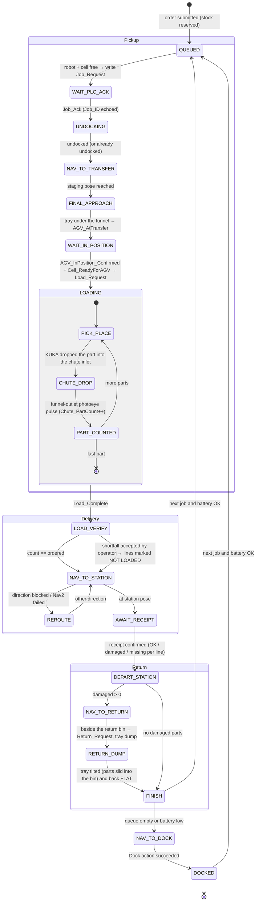
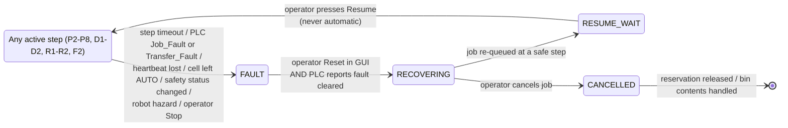

# APEx 2.0 — Job state machine

**Stage:** Audit & Architecture. Implemented in `apex_orchestrator` during the
Simulation Bring-up stage. All timeouts are **configuration values**
(`ros2_ws/src/apex_bringup/config/job_timeouts.yaml`). The defaults below are
starting points to tune during commissioning **[TBD]**, not measured values.

One **job** = one order = one TurtleBot trip:
**pickup** (KUKA → gravity chute → funnel onto the tray) → **delivery** →
**return** (only if damaged parts came back: the tray tilts them into the
return bin) → **finish**. Design: [`TRANSFER_AND_RETURN.md`](TRANSFER_AND_RETURN.md).

## 1. Diagram



Fault handling is shown separately to keep the main flow readable. **Every
active state above can go to `FAULT`**; the cause for each step is in the
table in section 2.



## 2. Steps, timeouts and faults

`T_*` names are keys in `job_timeouts.yaml`.

| # | State | Entry action | Success condition | Timeout (default) | On timeout / failure |
|---|---|---|---|---|---|
| P1 | `QUEUED` | job stored, stock reserved | robot free, cell `AUTO`, PLC heartbeat OK, battery ≥ `battery_min_start_pct` | — (waits) | job stays queued; GUI shows the reason |
| P2 | `WAIT_PLC_ACK` | write `Job_ID`, part list, `Job_Request` | `Job_Ack` with matching `Job_ID` | `T_plc_ack` = 10 s | `FAULT: PLC_NO_ACK` |
| P3 | `UNDOCKING` | `undock()` if docked | undocked | `T_undock` = 30 s | `FAULT: UNDOCK_FAILED` |
| P4 | `NAV_TO_TRANSFER` | route to the transfer **staging** pose (shorter clear direction) | Nav2 succeeded | `T_nav_leg` = 180 s | one reroute the other way; then `FAULT: NAV_BLOCKED` |
| P5 | `FINAL_APPROACH` | precise approach under the chute (fiducial dock) | within `transfer_xy_tol` / `transfer_yaw_tol` | `T_final_approach` = 45 s, `max_retries` = 3 | `FAULT: PARK_FAILED` |
| P6 | `WAIT_IN_POSITION` | write `AGV_AtTransfer` = 1 | `AGV_InPosition_Confirmed` (PLC photoeye/sensor) **and** `Cell_ReadyForAGV` | `T_in_position` = 15 s | `FAULT: NOT_IN_POSITION` |
| P7 | `LOADING` | write `Load_Request` | `Load_Complete` | `T_load_total` = 60 s + `T_per_part` = 30 s × parts | `FAULT: LOAD_TIMEOUT` (or the PLC's `Transfer_Fault` / `Job_Fault` code) |
| P7a | `PICK_PLACE` | (PLC) select KRL program for the part, start | KUKA dropped the part into the chute inlet (mode **D**, chosen) | (PLC) `T_pick` | PLC raises `Job_Fault` |
| P7b | `CHUTE_DROP` | - (gravity: chute + funnel) | funnel-outlet photoeye pulse | (PLC) `T_drop` | PLC raises `Transfer_Fault` |
| P8 | `LOAD_VERIFY` | compare `Chute_PartCount` with the ordered total | equal | — | **shortfall**: pause; GUI asks the operator to *retry missing parts*, *send with shortfall* (lines become **NOT LOADED**) or *cancel* |
| D1 | `NAV_TO_STATION` | route to `station_a` / `station_b`, shorter clear direction | Nav2 succeeded | `T_nav_leg` | reroute once the other way (`REROUTE`); both blocked → `FAULT: NAV_BLOCKED` |
| D2 | `AWAIT_RECEIPT` | GUI/REST prompt at the station | receipt confirmed: every line OK + damaged + missing = loaded qty | `T_receipt_remind` = 300 s (reminder, stack-light/GUI alert); `T_receipt_max` = 1800 s | after max: `FAULT: NO_RECEIPT` (robot stays parked, does not leave with parts) |
| R1 | `NAV_TO_RETURN` | route to `return_drop` | Nav2 succeeded | `T_nav_leg` | reroute / `FAULT: NAV_BLOCKED` |
| R2 | `RETURN_DUMP` (return_mode **tilt**, default) | write `Return_Request`; once the robot is still, command the tray `dump` (retry ≤ `tilt_start` = 5 s) | tray cycle done: TILTING → RAMP (hold 2 s) → RETURNING → FLAT | `T_tilt_dump` = 30 s | `FAULT: TILT_FAILED` / `TILT_TIMEOUT` / `TILT_REFUSED`; tray motor stopped |
| R2' | `AWAIT_RETURN_CONFIRM` (return_mode **manual**) | write `Return_Request`; GUI asks the operator to empty the return bin | operator confirms count | `T_return_remind` = 300 s | reminder only |
| F1 | `FINISH` | book inventory (below), release job | — | — | — |
| F2 | `NAV_TO_DOCK` | route to the dock staging pose, then `dock()` | `DockStatus.is_docked` | `T_dock` = 120 s, 2 retries | `FAULT: DOCK_FAILED` |

**Always active during every step**, each going straight to `FAULT`:
- PLC heartbeat stale > `T_heartbeat` = 2 s (`PLC_LINK_LOST`).
- TurtleBot status stale > 3 s (`ROBOT_LINK_LOST`).
- Cell leaves `AUTO`, or a safety status changes. **Read only**; we stop our sequence, the safety system has already acted.
- KUKA not ready during loading.
- Create 3 hazard / stuck / wheel-drop reported.
- Operator **Stop** in the GUI.
- **Tilt tray not FLAT** whenever the robot is about to undock or drive (`TRAY_NOT_FLAT`) - the robot
  never moves with the tray tilted; recovery: clear the tray, **Tray flat** (home), Reset, Resume.

## 3. Fault handling

- **Entering `FAULT`:**
  - cancel all Nav2 goals; the robot stops where it is, outside the cell by design;
  - write `Job_Fault_Station` = 1 to the PLC, which holds the transfer and ends the KRL program at a safe point; a tray dump in progress is stopped (motor off);
  - stack light shows the fault; the GUI shows the fault code, the step and the timestamp.
- **Recovery needs an operator Reset in the GUI** (logged with user and source) **and** the PLC reporting the cell fault cleared. Reset **never restarts motion by itself**: after reset the job is re-queued at a safe step (e.g. P4 navigate to transfer, or D1 navigate to station), and the operator must press **Resume**.
- **Parts already in the bin when a fault happens:** the GUI shows the bin contents (from the photoeye count) so the operator can decide whether to deliver, return or unload by hand.
- Safety events (E-STOP, guard opened, KUKA safety stop) are handled by the safety system. Our state machine only **observes** them and moves to `FAULT`. Reset of the safety system is a separate, physical action: the acknowledge button **outside the guarding**.

## 4. Routing around the loop

```text
route(target):
    for direction in sorted([CW, CCW], key=path_length_to(target)):
        if direction not blocked (or block expired after blocked_ttl_s = 120 s):
            send NavigateThroughPoses(corner waypoints of that direction + target)
            if succeeded: return OK
            if failed or no progress for blocked_timeout_s = 20 s:
                mark direction blocked (ttl), log, notify GUI
    return FAULT NAV_BLOCKED
```

- The corner waypoints for each direction live in `poses.yaml`, so the robot always stays in the corridor centre and never shortcuts through the FlexBase island.
- Nav2 still avoids small obstacles inside a corridor. A **reroute** happens only when a corridor is truly blocked, for example by an obstacle spanning the 5 ft width in the demo.

## 5. Inventory booking

| Event | Inventory effect |
|---|---|
| Order submitted | ordered qty **reserved** (on-hand − qty) |
| Part not loaded (short count, operator sends with shortfall) | reserved qty returned to on-hand **if the PLC reports the part was never picked**; if the PLC reports it dropped into the chute (`Parts_Placed`) but the funnel photoeye did not count it, it becomes a **lost-in-transfer** discrepancy for an operator to check (**[CONFIRM]** this rule) |
| Receipt: OK | consumed (delivered) |
| Receipt: damaged | stays on the tray; when the tray has tilted it into the return bin (`return_dumped`) → **quarantine** count (never restocked; count not verified unless the bin gets a sensor) |
| Receipt: missing | **discrepancy** (missing at delivery), no stock change |
| Return confirm count ≠ damaged qty (manual return mode) | difference logged as a discrepancy |
| Job cancelled before loading | reservation released |

## 6. Risk-assessment points in this sequence (⚠ RA)

- Robot parking under the funnel: pinch/crush points between funnel, chute support and robot; falling parts.
- The chute's opening in the guarding: no reach into the arm's danger zone (RA-20).
- Tilting tray: pinch points at the hinge and the bin rim; the tray only tilts with the robot still, the robot only drives with the tray flat (RA-21).
- Worker reaching into the delivery bin at a station: same, during `AWAIT_RECEIPT`.
- Fault recovery: no automatic restart; Resume needs an operator.

All collected in [`RISK_ASSESSMENT_POINTS.md`](RISK_ASSESSMENT_POINTS.md).

## Implementation status (Simulation Bring-up)

The machine is implemented in
[`ros2_ws/src/apex_orchestrator/apex_orchestrator/job_machine.py`](../ros2_ws/src/apex_orchestrator/apex_orchestrator/job_machine.py)
and tested in `ros2_ws/tests/test_job_machine.py`. Differences from the tables above:

| Design | Implementation | Why |
|---|---|---|
| `QUEUED` state | `IDLE` with a non-empty queue | same behaviour, one state fewer |
| `LOAD_VERIFY` (P8) | folded into `LOADING`: the PLC raises `COUNT_MISMATCH` (code 5) and the machine goes to `LOAD_SHORTFALL` | the PLC owns the count, the station mirrors it |
| Shortfall choices *retry / send / cancel* | *send* and *cancel* only | *retry missing parts* needs a PLC "re-pick these lines" request; added with the PLC program (`PLC_INTEGRATION.md`) |
| `FINISH` (F1) | `_finish_job` emits `job_done`; inventory booking is StationCore's job (Station HMI Upgrade) | one writer for the database |
| Timeouts | all in `apex_bringup/config/job_timeouts.yaml` | tune without code changes |

Damaged parts (team decision 2026-11-19) ride back on the tray and are tilted into the return
bin by the robot (`RETURN_DUMP`, `apex_tilt`). The old operator-empties-the-bin step remains as
`return_mode: manual` in `job_timeouts.yaml`.

