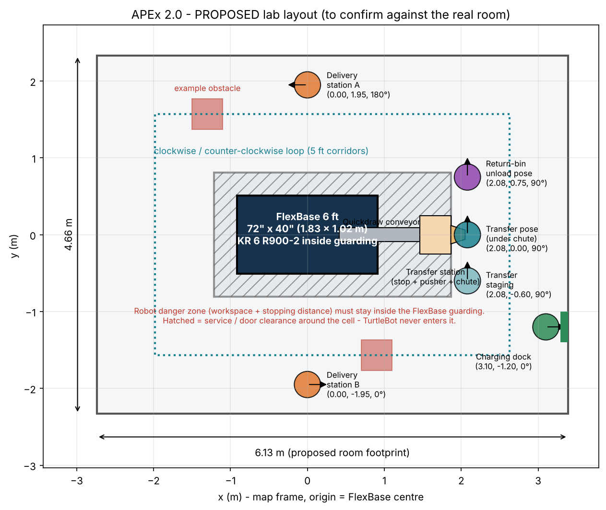

# APEx 2.0 — Proposed lab layout

**Stages:** proposed in Audit & Architecture, built into the simulation in
Simulation Bring-up. **This is still a proposal.** The real room, the FlexBase
orientation and which end the chute leaves the guarding are still to be confirmed
([`OPEN_QUESTIONS.md`](OPEN_QUESTIONS.md) Q-L1 to Q-L5).

**Single source of truth:** every number on this page lives in
[`ros2_ws/src/apex_bringup/config/lab.yaml`](../ros2_ws/src/apex_bringup/config/lab.yaml).
The Gazebo worlds, the Nav2 map, the orchestrator's poses and loop corners and
the figure below are all generated from it. **Poses live in YAML, never in
code.** If this page and `lab.yaml` ever disagree, `lab.yaml` wins.

The figure is generated by `tools/draw_lab_layout.py`, which reads `lab.yaml`.
After changing `lab.yaml` run `python3 ros2_ws/src/apex_bringup/apex_bringup/generate_lab.py`
(worlds + maps) and `python3 tools/draw_lab_layout.py` (figure).

## 1. Frame and fixed geometry

- **Map frame:** origin at the centre of the FlexBase footprint, +x along
  its 72" length toward the chute (east end), +y to the left, metres, yaw in
  degrees (counter-clockwise from +x). On the real robot the saved SLAM
  map is aligned to this frame, or the poses are re-measured in the map's
  frame.
- **FlexBase 6 ft:** 72" × 40" = **1.829 m × 1.016 m** (confirmed).
  Maximum height 7'6" (brochure).
- **Island** (TurtleBot keep-out): FlexBase + 0.30 m service/door clearance
  on every side, extended 0.45 m on +x for the chute support and the
  return bin: x ∈ [−1.21, 1.36], y ∈ [−0.81, 0.81]. (No conveyor run-out
  any more - the KUKA drops parts straight into the chute, see
  [`TRANSFER_AND_RETURN.md`](TRANSFER_AND_RETURN.md).) Becomes a Nav2
  **keepout zone**. **⚠ RA**: door swing and operator access space must be
  checked against the real Lexan doors.
- **Loop corridors:** 5 ft = **1.524 m** wide, all the way round the island.
  The brief describes two hallway corridors (one each side) joined at the
  ends; this proposal makes all four sides 5 ft so the robot can pass in
  either direction.
- **Proposed room footprint:** 5.63 m × 4.66 m (island + corridors).
  **[CONFIRM the room fits; otherwise the corridors or the clearance shrink]**

## 2. Named poses

| Name | x (m) | y (m) | yaw (°) | Purpose / why here |
|---|---|---|---|---|
| `transfer` | 1.65 | 0.00 | 90 | Tray centre directly under the **funnel** at the end of the gravity chute, **outside the guarding**. The robot faces along the east corridor, so it can leave either way. Its body (radius 0.189 m in Nav2's footprint) clears the chute support (x = 1.36) by about 10 cm. Reached via the staging pose plus a precise final approach (± 3 cm). |
| `transfer_staging` | 1.65 | −0.60 | 90 | Where the Nav2 route ends and the precise approach starts. |
| `return_drop` | 1.65 | 0.62 | 90 | Beside the **return bin** (x 1.10-1.36, y 0.44-0.80): the robot tilts its tray to the left (west) and the damaged parts slide into the bin. Out of the funnel's fall line, so a return can never be confused with loading. |
| `dock` | 2.60 | −1.20 | 0 | Charging dock on the outer wall of the east corridor, near the chute (short trip between jobs), out of the loop's driving line. Dock against the outer wall at x = 2.89. Needs a wall outlet. **[CONFIRM]** |
| `station_a` | 0.00 | 1.75 | 180 | Delivery station A on the outer side of the north corridor, in front of the station table against the north wall. |
| `station_b` | 0.00 | −1.75 | 0 | Delivery station B on the outer side of the south corridor, the opposite side to A. |

The TurtleBot footprint is about Ø 0.34 m. Corridor centre lines are at
y = ±1.57 m and x = 2.13 / −1.98 m. Station poses sit 0.18 m off the corridor
centre toward the outer wall: the station tables (1.0 × 0.30 m) stand against
the walls (y = ±2.03 to ±2.33), so the robot's edge stops about 0.11 m in
front of the table edge and about 0.77 m of corridor stays free between the
robot and the island. With one robot nothing needs to pass it.

## 3. Loop routing waypoints (corridor centre line)

| Corner | x (m) | y (m) |
|---|---|---|
| NE | 2.13 | 1.57 |
| NW | −1.98 | 1.57 |
| SW | −1.98 | −1.57 |
| SE | 2.13 | −1.57 |

- **Clockwise** from the transfer station to station A: transfer → SE → SW → NW → station A.
- **Counter-clockwise** to station A: transfer → NE → station A.

The orchestrator builds both, takes the shorter clear one and, if the
corridor is blocked, reroutes the other way
([`JOB_STATE_MACHINE.md`](JOB_STATE_MACHINE.md) §4). Station A is shorter
counter-clockwise from the transfer station, and station B is shorter
clockwise. A box placed in the short corridor forces the long way round,
which is exactly the reroute demo.

## 4. Obstacle demo positions

Configurable obstacle models in the Gazebo world (Simulation Bring-up). For
the reroute demo the obstacle must span the corridor width (e.g. a
1.5 m wide barrier), otherwise Nav2 simply drives round it:

| Obstacle | Pose | Effect |
|---|---|---|
| `box_small` | (−1.30, 1.57) | Nav2 avoids it inside the north corridor, no reroute |
| `barrier_north` | (1.40, 1.57), across the corridor | blocks the counter-clockwise route to A → reroute clockwise |
| `barrier_south` | (0.90, −1.57), across the corridor | blocks the clockwise route to B → reroute counter-clockwise |

## 5. The Gazebo model of the lab

The team decided to model the lab in Gazebo for the TurtleBot's benefit:

- `generate_lab.py` builds the worlds `apex_lab`, `apex_lab_obstacles`,
  `apex_lab_blocked_north`, `apex_lab_blocked_south` (walls, FlexBase box,
  gravity chute + funnel, chute support, return bin, station tables, obstacles).
- It also rasterises the same geometry into `maps/apex_lab.pgm/.yaml`
  (0.05 m/pixel, the TurtleBot 4 SLAM default). AMCL localises on this map in
  simulation and can be used on the real robot until a SLAM map of the real
  room is recorded.
- When the real room is measured, update `lab.yaml`, regenerate, and record a
  SLAM map with the real TurtleBot. Compare the two: the generated map is the
  check that `lab.yaml` matches the room.
- The same world is the training environment for the **Learning-Based
  Navigation** stage (see [`ROADMAP.md`](ROADMAP.md)).

## 6. Things to measure in the real room

1. Room dimensions, door positions, columns, benches.
2. FlexBase position and orientation; **where the chute can pass through the guarding**, the height the KUKA can drop parts in (sets the chute length and slope), and space for the return bin.
3. Where the operator stands, where the pushbutton / acknowledge box is, and which side the Lexan doors open.
4. Wall outlet for the charging dock.
5. Floor: flat, no thresholds; the TurtleBot has 4.5 mm ground clearance.
6. Wi-Fi coverage (5 GHz) along the whole loop.
