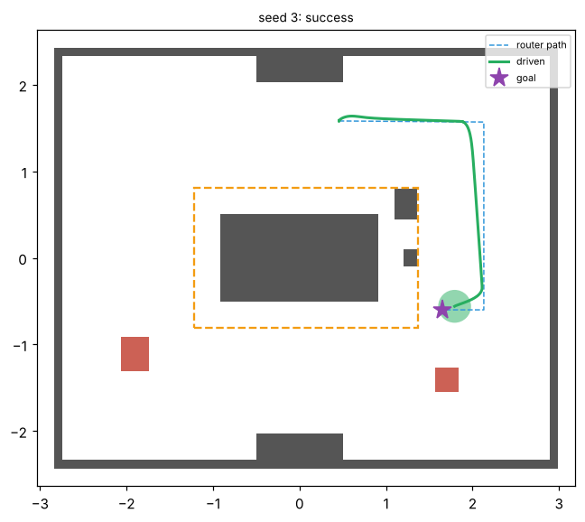
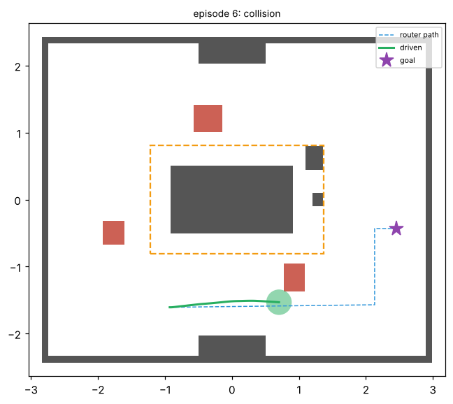

# APEx 2.0 — Learning-Based Navigation (RL)

**Stage:** Learning-Based Navigation (team decision A-10, "RL policy is a go"). This page covers
the **training environment**, built first. Package:
[`ros2_ws/src/apex_rl`](../ros2_ws/src/apex_rl/README.md).

Goal of the stage: a learned driving policy that is at least as good as Nav2's controller on
our loop, trained in simulation and only then tried on the real TurtleBot behind the existing
safety layers.

---

## 1. What the policy does (assumption for Q-R1)

The policy does the **local driving**: it follows the corridor waypoints the orchestrator's loop
router produces, avoids obstacles in the corridor, stays out of the FlexBase island, and stops
on the goal. Everything else stays as it is:

| Stays rule-based | Learned |
|---|---|
| job state machine, PLC handshake, faults | — |
| route choice (clockwise / counter-clockwise, reroute when blocked) | — |
| precise parking under the funnel, docking | — |
| — | **driving each leg**: `cmd_vel` from lidar + next waypoints |

If the team decides otherwise (Q-R1), the environment is the place to change: the observation
and reward are in one file (`apex_rl/env.py`).

## 2. The environment (`ApexNavEnv`, Gymnasium)

| Part | What |
|---|---|
| World | **built from `lab.yaml`** - the same walls (Room 101 from CAD), FlexBase, chute support, return bin, tables and keepout island as the Gazebo worlds and the Nav2 map. When `flexbase_in_room` is measured (M1), training follows the real room. The real furniture is not in it (only in the team's map) - random boxes stand in for clutter |
| Robot | circle r = 0.19 m (Nav2 footprint); unicycle; v ≤ 0.31 m/s (safe mode), reverse ≤ 0.10 m/s, ω ≤ 1 rad/s; acceleration limits like Nav2's velocity smoother; 10 Hz control |
| Lidar | 36 beams over 360° (RPLIDAR A1 downsampled), 0.15-3.5 m. **The keepout island is added as virtual walls**, the same way Nav2's costmap sees the keepout mask - on the robot, a policy node would merge the mask into the scan from the map pose |
| Episode | random start (a named pose or a corridor point) and goal ≥ 1.5 m away; the **loop router** gives the waypoints (20 % of episodes the longer way round); ends on arrival (within 0.15 m **and stopped**), a collision, entering the keepout, or a timeout |
| Obstacles | 0-3 random boxes (0.2-0.45 m) per episode, always leaving ≥ 0.6 m of corridor free (together, not just one by one) - blocked corridors are the router's job, not the policy's |
| Domain randomisation | lidar noise σ 0-3 cm, 0-5 % dropped beams, one-step action latency (50 % of episodes), actuation scale 0.9-1.1, wheel slip, start-pose noise |
| Observation | 47 numbers: 36 ranges, next two waypoints (distance, sin/cos bearing), "next is the final goal" flag, current v and ω, previous action |
| Action | 2 numbers in [-1, 1]: forward speed, turn rate |
| Reward | +10 per metre of progress to the current waypoint, +0.5 per waypoint, +10 on arrival, −10 for a collision or keepout, a penalty for passing within 15 cm of anything, small smoothness and time penalties |
| Speed | ~5 000 env steps/s per CPU core (pure numpy, no ROS / Gazebo); PPO training ~2 100 steps/s on 4 cores |

## 3. Reference results

Evaluated on 100 fixed held-out seeds (10 000+, never used in training). Baseline re-run on
2026-11-27 with Room 101's CAD walls (before: 100 % / 96 % in the plain corridor box); the PPO
rows are from the corridor box:

| Driver | Scenario | Success | Collision | Keepout | Timeout | Time to goal |
|---|---|---|---|---|---|---|
| random actions | empty / clutter | 0 % / 0 % | 54 % / 58 % | 30 % / 22 % | 16 % / 20 % | - |
| **baseline** (waypoint follower + reactive avoidance) | empty | **100 %** | 0 % | 0 % | 0 % | 17.1 s |
| **baseline** | clutter (training distribution) | **94 %** | 0 % | 0 % | 6 % | 21.0 s |
| PPO, 300 k steps (~3 min, pipeline check) | empty | 100 % | 0 % | 0 % | 0 % | 16.9 s |
| PPO, 300 k steps (~3 min, pipeline check) | clutter | 79 % | 21 % | 0 % | 0 % | 18.7 s |

The **baseline** is the bar: a learned policy is only interesting if it beats it (and, later,
Nav2 MPPI in Gazebo) on success rate with **zero** collisions and keepout violations.

## 4. How to train and evaluate (team's machine)

```bash
python3 -m pip install -r ros2_ws/src/apex_rl/requirements.txt
cd ros2_ws && export PYTHONPATH=$(ls -d src/apex_* | tr '\n' ':')     # or source install/setup.bash

python3 -m apex_rl.evaluate --policy baseline                      # the bar
python3 -m apex_rl.train --timesteps 3000000 --envs 8 --out runs/ppo_apex      # ~25 min on 4-8 cores
python3 -m apex_rl.evaluate --policy sb3:runs/ppo_apex/best_model.zip --episodes 200 --plots runs/ppo_apex/eval_plots
```

`--plots` saves a picture of every failed episode (lab, obstacles, router path, driven path) -
look at them; they show what the policy has not learned yet. `runs/` is git-ignored; keep good
models in a release or a shared drive and note them in this file.

## 5. Status

* Built and tested (CPU, in the cloud build environment): environment, ray-caster, baseline,
  evaluation, training pipeline. 12 tests (`ros2_ws/tests/test_rl_*.py`): exact ray-casting,
  Gymnasium API check, determinism per seed, collision / keepout / arrival events, reward
  sense, baseline ≥ 85 % and random < 10 %.
* PPO pipeline check: 300 000 steps on 4 CPU cores (~3 min, ~2 100 steps/s). Already drives the
  empty lab perfectly (100 %, slightly faster than the baseline) but still **clips obstacles near
  the corridor centre line** (21 % collisions with obstacles, baseline 0 %). That is a
  **smoke test, not a trained policy** - a real run needs ≈ 3-10 M steps. The model was not kept.

| Baseline, obstacles - arrives | PPO after 300 k steps - clips an obstacle |
|---|---|
|  |  |

## 6. Next steps (R2-R4 in `TURTLEBOT_STATUS.md`)

1. **Train for real** (3-10 M steps) on the team's machine; tune reward weights if the failure
   pictures show a pattern (e.g. timid near obstacles, overshooting the goal).
2. **Validate in Gazebo**: a `rl_policy` node (to write) that publishes `cmd_vel` from `/scan` +
   the keepout mask + the orchestrator's waypoints, behind Nav2's **collision monitor** and the
   velocity smoother; same three demos as the Simulation Bring-up stage; compare with MPPI.
3. **Real robot** only after it beats MPPI in Gazebo: empty loop, low speed limit, a person ready
   to stop it (RA-16). Switchable at launch (`controller:=mppi|rl`), MPPI stays the default.
4. Re-train whenever `lab.yaml` changes (the real room measurements, M1).

**Safety:** the policy never replaces the collision monitor or the Create 3's bump / cliff /
hazard safety, never exceeds the safe-mode speed, and the keepout island stays a no-go area.
It is a risk-assessment item (RA-16).
