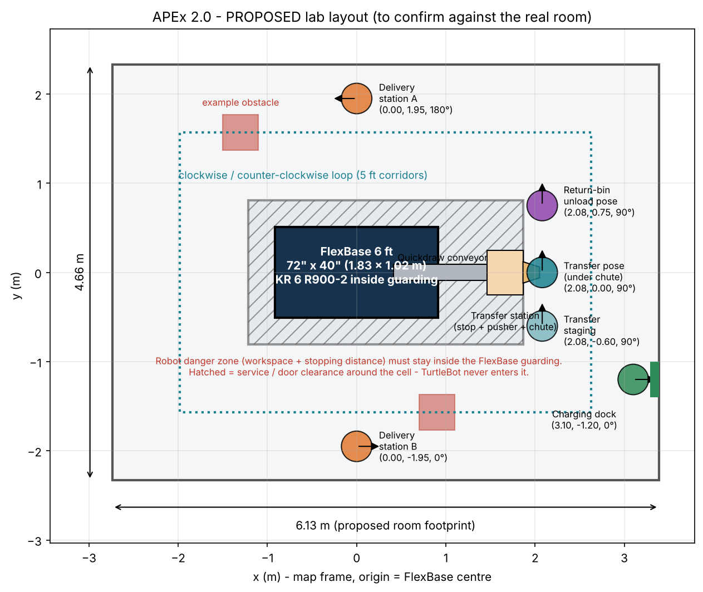

# APEx 2.0 — Transfer to the TurtleBot and damaged-part return

**Team decision 2026-11-19.** This replaces the conveyor design.

1. **Transfer (transfer mode D):** the KUKA picks each part and **drops it into a gravity
   chute**. The chute runs through the FlexBase guarding, and a **funnel** at its exit puts the
   part straight onto a fixed spot on the TurtleBot's tray. There is no conveyor, stop station
   or pusher.
2. **Damaged-part return:** the TurtleBot carries the damaged parts to a **return bin next to
   the FlexBase**. A **motor on the robot tilts its tray from flat into a ramp**, the parts slide
   off into the bin, and the tray goes back flat.

Every dimension below comes from
[`ros2_ws/src/apex_bringup/config/lab.yaml`](../ros2_ws/src/apex_bringup/config/lab.yaml)
(simulation values, `[TBD]` until built and measured). The layout figure, the Gazebo worlds and
the Nav2 map are generated from that file.



> **Assumption to confirm (Q-R4):** this design puts the tilting platform **on the TurtleBot**,
> so the robot itself slides the parts off. If you meant a motorised platform **at the bin**
> instead, the software changes are small: the tilt controller moves to the PLC and the robot
> only parks. The rest of this document still applies.

---

## 1. Transfer: KUKA → gravity chute → funnel → robot tray

```
 inside the guarding                    │ guard panel (opening)  outside the guarding
                                        │
   shelf ──KUKA picks──► chute inlet ───┼──────╲  gravity chute (≈30°)
                         (x 0.80, z 1.10)│       ╲
                                        │        ╲__ funnel (z 0.62 → 0.48)
                                        │            ▼  photoeye at the funnel outlet counts the part
                                        │        [ tray on the TurtleBot ]  transfer pose (1.65, 0.00)
```

### 1.1 Sequence (per job)

| # | Who | What | Tags (`plc_tags.yaml`) |
|---|---|---|---|
| 1 | Station → PLC | job: part codes + quantities | `Job_ID`, `Job_PartCodes`, `Job_PartQty`, `Job_Request` |
| 2 | PLC → Station | job accepted | `Job_Ack` |
| 3 | Robot | drives to `transfer_staging`, then parks precisely at `transfer` (tray centre under the funnel) | `AGV_AtTransfer` |
| 4 | PLC | confirms the robot is in position with **its own sensor** | `AGV_InPosition_Confirmed`, `Cell_ReadyForAGV` |
| 5 | Station → PLC | start loading | `Load_Request` |
| 6 | PLC + KUKA | per unit: select the KRL program for the part code, pick, move over the chute inlet, release, return home | `KUKA_ProgramNo`, `KUKA_Busy`, `Parts_Placed` |
| 7 | Gravity | the part slides down the chute, and the funnel centres it onto the tray | — |
| 8 | PLC | the funnel-outlet photoeye counts the part | `Chute_PartCount` (`Transfer_Complete` pulse) |
| 9 | PLC → Station | all counted → `Load_Complete`; short count → `Job_Fault` + `Fault_Code` 5 (COUNT_MISMATCH) → operator chooses *send* or *cancel* | `Load_Complete`, `Job_Fault`, `Fault_Code` |

`Transfer_Mode` = 4 (D). `Conveyor_Run`, `StopStation_Release` and `Pusher_Extend` stay in the
UDT but are unused in mode D. The cell simulator (`apex_cell_sim`) runs mode D by default:
pick → drop → count.

### 1.2 Requirements for the chute and funnel

| Item | Value in `lab.yaml` | Why / what to check |
|---|---|---|
| Chute inlet | x 0.80 (inside the guarding), z 1.10 | Within the KR 6 R900-2's reach (901 mm) from where it is mounted (Q-K4). The KUKA releases the part **just above** the inlet: a short, repeatable drop. |
| Chute slope | ≈ 30° (1.10 → 0.62 m over 0.85 m) | Steep enough for the part to slide **every time**. Measure the friction angle of each part on the chute material and add 5-10°. Use a low-friction liner (UHMW-PE). |
| Chute section | 0.20 m wide, side walls | Wider than the largest part (Q-S4), and side walls high enough that parts cannot jump out. |
| Guard opening | where the chute crosses the east panel (x 0.9145) | **Must not let a hand reach the robot's danger zone** (ISO 13857 opening size vs distance). Make it no bigger than the chute section, add a tunnel/hood if needed. **⚠ RA-20** |
| Funnel | mouth 0.20 m at z 0.62 → outlet 0.08 m at z 0.48 | The outlet puts every part on the **same spot** of the tray. Outlet bigger than the largest part. Outlet at least 0.13 m above the robot top (0.351 m), so the tray (~0.08 m) fits underneath. |
| Part counter | photoeye across the funnel outlet | One count per part. This is the truth for "loaded" (the not-loaded rule in `JOB_STATE_MACHINE.md` §5). |
| Drop onto the tray | ≈ 0.05-0.10 m below the outlet | Short drop, padded tray floor: no damage, no bounce out. |
| Chute support | post at x 1.20-1.36, inside the island | Carries the chute exit and the funnel; the robot never touches it (≈ 9 cm clearance from Nav2's footprint). |

### 1.3 Parking under the funnel

The tray centre must sit under the funnel outlet within about **± 3 cm** (outlet 0.08 m into a
tray nest). Nav2 alone is set to 6 cm (`nav2_overrides.yaml`). Plan (Q-S7):

1. Measure 20 parkings with AMCL on the real map.
2. If any is more than 3 cm off, add the fine approach: an AprilTag on the chute support, read
   by the OAK-D, plus `opennav_docking` for the last 0.6 m from `transfer_staging`.
3. Fall-back on the tray: a wide funnel-shaped nest that guides the part into position.

The PLC must confirm the robot in position with **its own sensor** (step 4) before the KUKA
releases a part, e.g. a diffuse sensor or a target plate under the funnel. If the robot is not
there, a part would fall to the floor.

---

## 2. Return: tilting tray → return bin

```
   return bin (inside the island, rim 0.30 m)     robot at return_drop (1.65, 0.62), facing north
   ┌──────────┐                                   ┌───────┐
   │          │  ◄── parts slide off ───  ╱╱╱╱╱╱  │ tray  │  tray tilts to the LEFT (west) ≈35°
   │          │                                   │  TB4  │
   └──────────┘                                   └───────┘
```

### 2.1 Sequence

| # | Who | What |
|---|---|---|
| 1 | Worker at the station | receipt: OK / damaged / missing per line. Good parts come off the tray, **damaged parts stay on it** (one tray, see 2.2). |
| 2 | Orchestrator | drives to `return_drop`, beside the return bin; writes `Return_Request` = 1 so the PLC / Ignition can show it |
| 3 | Orchestrator → tray | `dump` once the robot has been still for 1 s (retried for up to `tilt_start` = 5 s) |
| 4 | Tray | FLAT → TILTING (motor up to the **ramp switch**) → RAMP (hold `hold_s` = 2 s while parts slide) → RETURNING (motor down to the **flat switch**) → FLAT |
| 5 | Orchestrator | `return_dumped` event, `Return_Request` = 0, next job or dock |
| 6 | Station | books the reported damaged quantity into **quarantine** automatically. The note "count not verified" is kept until a sensor counts the bin (Q-R6). |

### 2.2 Tray design (recommendation)

**One tray does both jobs:** parts land on it from the funnel, the worker takes the good ones
at the station, and the damaged ones ride back and are tilted off. This means only one fixture
on the 270 × 250 mm top plate. The tray:

* sits on a **hinge along the robot's forward axis** at the right-hand edge and lifts its right
  side, so the parts slide off the **left** edge (towards the bin at the return pose);
* has low walls on three sides and a low lip (~10 mm) on the left side, so parts stay on while
  driving and slide over the lip once tilted;
* has a ramp lip that, when tilted, reaches past the robot's body and over the bin rim. The bin
  edge is ≈ 0.29 m from the robot centre at the return pose, so the lip (or a fixed catch-ramp
  on the bin, mounted above robot height) has to bridge that gap. **Mock this up early** (Q-R5);
* has a nest under the funnel outlet in the tray centre (the transfer pose aligns it).

Alternative: a separate, smaller tilting compartment for returns next to a fixed delivery
nest. That means more parts and more mass, but good and damaged parts never share a surface.

### 2.3 Motor, switches, controller (hardware not chosen yet)

| Item | Suggestion | Notes |
|---|---|---|
| Actuator | geared DC motor with a lead screw or crank, **or** a high-torque servo | must hold the tray flat while driving (self-locking gear or servo hold); tilt ≈ 35° in ≈ 1-2 s |
| Position | **two limit switches**: FLAT and RAMP | the software never trusts motor time alone; both made at once = fault |
| Controller | small microcontroller (Arduino Nano / RP2040) on a USB port of the robot's Pi | runs the motor driver; **stops at each limit switch by itself** and **stops if commands stop for 0.3 s** (watchdog) |
| Protocol | Pi → MCU `M+` / `M-` / `M0`; MCU → Pi `S <flat> <ramp>` at ≥ 20 Hz | `apex_tilt/tilt_core.py: SerialTiltBackend` (written, **untested**) |
| Power | **check the budget**: TurtleBot 4 user power is 12 V @ 300 mA, 5 V @ 500 mA, VBAT @ 300 mA (user manual) | a motor's stall current will exceed this. Use a separately fused supply from the battery (VBAT, PTC-fused at the UI board) through a buck converter, or a small dedicated battery. Measure the stall current first (Q-R7) |
| Mass | tray + mechanism + parts ≤ 9 kg payload | keep the centre of gravity low and central |

### 2.4 Software (built and tested in simulation)

| Piece | Where | What it does |
|---|---|---|
| `TiltController` | `ros2_ws/src/apex_tilt/apex_tilt/tilt_core.py` | state machine above; refuses `dump` unless FLAT **and** robot still ≥ 1 s; FAULT on a move timeout (5 s), on robot motion during a cycle, or on both switches made; FAULT cleared only by `home` (robot parked) |
| `tilt_platform` node | `apex_tilt/tilt_node.py`, **runs on the TurtleBot** | `/apex/tilt/state` (TiltState, 10 Hz), `/apex/tilt/command` (TiltCommand: dump / home / stop); watches `odom`; no fresh odometry = treated as moving |
| Orchestrator | `apex_orchestrator/job_machine.py` | new step `RETURN_DUMP`; **interlock: the robot never undocks or drives unless the tray reports FLAT** (fault `TRAY_NOT_FLAT`); faults `TILT_REFUSED`, `TILT_FAILED`, `TILT_TIMEOUT`; operator action `tray_home`; any fault during a dump also stops the tray motor |
| Config | `job_timeouts.yaml` | `return_mode: tilt` (or `manual` for the old operator-empties-the-bin step), `tilt_dump: 30`, `tilt_start: 5` |
| Station HMI | Robot & Cell page | tray state chip, **Tray flat (home)** button, *Action required* row for tray faults, simulation fault `tray_jam`; return booked into quarantine automatically |
| Launch | `apex.launch.py tilt:=sim\|robot\|none` | `sim` starts a simulated tray on the PC; `robot` expects `tilt_platform` on the TurtleBot (`--ros-args -p backend:=serial`) |

Fault recovery: **clear the tray by hand with the motor stopped**, press *Tray flat* (robot must
be parked), then *Reset*, then *Resume*. The orchestrator drives back to the return pose and
dumps again.

---

## 3. Safety points (team risk assessment)

| RA | Hazard | Measure in this design |
|---|---|---|
| RA-01 / RA-20 | Hand through the chute's guard opening into the arm's danger zone | Opening no larger than the chute, hood/tunnel per ISO 13857; the KUKA releases parts only inside the guarding |
| RA-08 / RA-18 | Falling parts at the funnel; hand under the funnel | The PLC releases a part only with the robot confirmed in position by its own sensor and no operator request active; padded tray; guard around the funnel outlet |
| RA-21 | Tilting tray pinch points; robot driving with the tray tilted | Interlock both ways: tray only tilts when the robot is still; robot only drives when the tray is FLAT (switch); motor stops on any fault; the MCU stops at the switches and on a watchdog |
| RA-22 | Tray motor power wiring on the robot | Separate fuse, no overload of the TurtleBot's user power rails |
| RA-10 | Hands in the tray at the station | Receipt confirmation includes "hands clear"; robot does not move before the receipt |

---

## 4. Open questions

Q-S4 (parts: size, weight, friction), Q-S5 (real chute geometry), Q-S7 (parking accuracy),
Q-K4 (arm reach to the chute inlet), **Q-R4 to Q-R7** (tray on the robot vs at the bin, tray
mock-up and lip reach, return counting, motor power) - see
[`OPEN_QUESTIONS.md`](OPEN_QUESTIONS.md).

## 5. Test status

* Simulation: cell mode D, the full tray cycle, both interlocks, a tray jam with home → reset →
  resume, and the ROS path through the real `tilt_platform` + orchestrator + PLC-bridge nodes
  (rclpy stand-in). Headless demo (c) ends with `return_dumped`.
* **Not tested:** any real hardware. That includes `SerialTiltBackend`, the microcontroller
  firmware (not written), the chute, the funnel and the tray.
