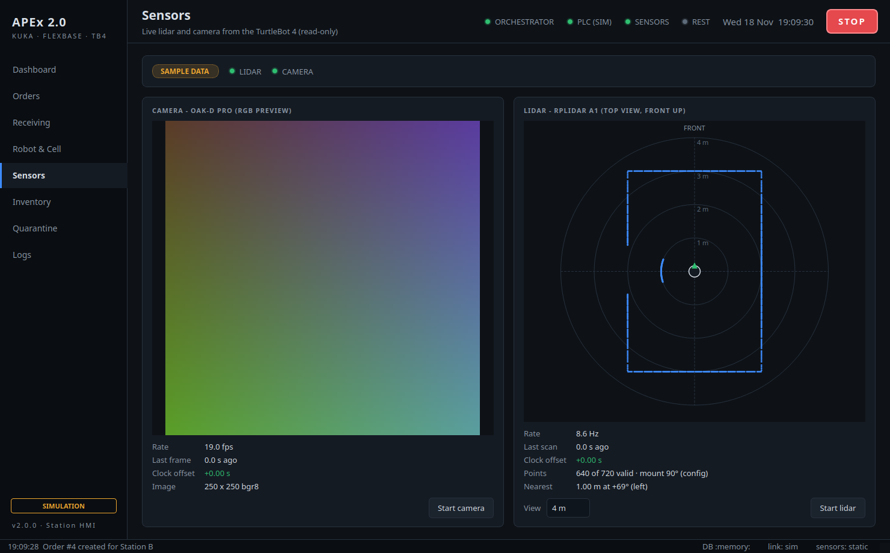

# TurtleBot 4 on the lab router

How to reach the real TurtleBot 4 from the station laptop over Wi-Fi: addresses,
one-time setup, daily use (terminal and the station GUI's **Sensors** page), the
clock-sync chain, every change made on the robot, and what to do when something
stops working. Set up on 2026-11-18 (robot image v2.0.2, ROS 2 Jazzy); moved to the Nighthawk
R6700v3 router on 2026-11-19.

## Quick start

1. **Laptop:** plug its USB-Ethernet adapter into a **yellow LAN port on the router**. Keep the
   school Wi-Fi (BlueWiFi) on for internet.
2. **Robot:** power it on with the laptop already on the router. The robot gets its time
   from the laptop at boot. Wait for the chime; the top line of its screen shows
   `192.168.0.3`. If it shows `unknown`, see [Troubleshooting](#troubleshooting).
3. **Undock it.** The dock power saver is **on**: the lidar and camera switch off on the dock
   so it charges faster, and come back when it leaves (otherwise press **Start lidar /
   Start camera** on the Sensors page).
4. **Terminal check:**

   ```bash
   source /opt/ros/jazzy/setup.bash
   export ROS_DOMAIN_ID=0 RMW_IMPLEMENTATION=rmw_fastrtps_cpp
   ros2 topic hz /scan           # ~8-10 Hz
   ssh ubuntu@192.168.0.3        # key login, no password
   ```

5. **Station GUI with live lidar + camera:**

   ```bash
   source /opt/ros/jazzy/setup.bash
   export ROS_DOMAIN_ID=0 RMW_IMPLEMENTATION=rmw_fastrtps_cpp
   . ~/apex-venv/bin/activate
   cd ~/APEx-2.0/station
   python -m apex_station.app --sensors ros          # open the "Sensors" page (Ctrl+5)
   ```

   Close the GUI or leave the Sensors page when you don't need the camera. The camera stream
   is the heaviest thing on the Wi-Fi link.
6. **Drive it with the keyboard** (robot on the floor):
   `python3 ~/APEx-2.0/station/tools/teleop_wasd.py`. See
   [Driving with the keyboard](#driving-with-the-keyboard-w-a-s-d).

## Addresses

| Device | Address | How it connects |
|---|---|---|
| Router: Netgear Nighthawk R6700v3 | `192.168.0.1` | Admin page `http://192.168.0.1` (type the IP - `routerlogin.net` opens Netgear's help site while the laptop's internet is on the school Wi-Fi). No internet uplink. Wi-Fi `NETGEAR81` (2.4 GHz) and `NETGEAR81-5G` (5 GHz, ch 153). LAN changed from the factory `192.168.1.1`; DHCP pool `.10-.254`. |
| Station laptop | `192.168.0.2` (reservation for `00:05:1B:8B:19:FC`) | USB-Ethernet adapter `enx00051b8b19fc` into a router LAN port. Internet stays on BlueWiFi. |
| TurtleBot 4 Raspberry Pi | `192.168.0.3` (reservation for `D8:3A:DD:08:5B:AC`) | Wi-Fi `NETGEAR81-5G` (405 Mbit/s), fallback `NETGEAR81`. Hostname `turtlebot4`, user `ubuntu`. |
| Pi wired port (recovery) | `192.168.185.3` | Cable straight from the laptop into the robot. Laptop side gets `192.168.185.10`. |
| Create 3 base | `192.168.186.2` | Internal USB link to the Pi (`192.168.186.3`) only. Web UI reachable from the Pi. |

The Wi-Fi password is kept with the team, not in this repository.

**Why the laptop is cabled to the router instead of joining its Wi-Fi:** the router has no
internet, and a laptop has one Wi-Fi radio. On the router's Wi-Fi it would lose internet.
Joining `NETGEAR81-5G` also works if internet is not needed. A cheap USB Wi-Fi adapter would
allow both at once.

## One-time setup of a station laptop

Already done on the Precision 7680 laptop. Repeat on any other Ubuntu 24.04 computer.

1. **ROS 2 Jazzy** (`ros-jazzy-desktop` plus the TurtleBot packages in
   [`SIMULATION.md`](SIMULATION.md)).
2. **Station Python environment**, which also sees ROS's packages:

   ```bash
   python3 -m venv --system-site-packages ~/apex-venv
   . ~/apex-venv/bin/activate && pip install -r ~/APEx-2.0/station/requirements.txt
   ```

3. **SSH key on the robot** (robot cabled or on Wi-Fi; password is the robot's `ubuntu` password):

   ```bash
   ssh-copy-id ubuntu@192.168.0.3
   ```

4. **Wired profile** that works plugged into the router *and* straight into the robot:

   ```bash
   nmcli con mod "Wired connection 2" ipv4.method auto ipv4.addresses 192.168.185.10/24 \
     ipv4.may-fail yes ipv4.never-default yes ipv4.dhcp-timeout 10 ipv6.method link-local ipv6.may-fail yes
   ```

   `never-default` keeps internet on the school Wi-Fi.
5. **Time server for the robot** (the robot has no internet):

   ```bash
   sudo apt install -y chrony
   printf 'allow 192.168.0.0/24\nlocal stratum 8\n' | sudo tee /etc/chrony/conf.d/turtlebot.conf
   sudo systemctl restart chrony          # must restart AFTER writing the file
   sudo ufw allow from 192.168.0.0/24 to any port 123 proto udp
   ```

   The robot expects its time server at **192.168.0.2**. A different laptop must take that
   reservation, or the robot's `/etc/chrony/chrony.conf` must be changed.
6. In the router, reserve the laptop's address (LAN Setup → Address Reservation).

## Daily use

```bash
source /opt/ros/jazzy/setup.bash
export ROS_DOMAIN_ID=0 RMW_IMPLEMENTATION=rmw_fastrtps_cpp   # add both lines to ~/.bashrc
ros2 topic list                            # /scan /odom /imu /tf /battery_state /oakd/... /cmd_vel ...
ssh ubuntu@192.168.0.3                     # shell on the robot
rsync -av my_pkg/ ubuntu@192.168.0.3:~/ros2_ws/src/my_pkg/   # copy code to the robot
```

Measured over Wi-Fi on 2026-11-18:

| Topic | Rate at the laptop | Notes |
|---|---|---|
| `/scan` | 8.6-10 Hz | RPLIDAR A1, frame `rplidar_link`, mounted **+90°** to `base_link` |
| `/odom` | 20 Hz | |
| `/imu` | 33 Hz | |
| `/oakd/rgb/preview/image_raw` | 10 fps (all of them) | 250x250 `bgr8`, ~1.9 MB/s uncompressed. The camera was lowered from 30 fps; at 30 fps it saturated the Wi-Fi (see Findings). |
| `/battery_state`, `/dock_status` | 1 Hz-ish | |

### Station GUI - Sensors page

`python -m apex_station.app --sensors ros`, or set `sensors.mode: "ros"` in
`station/config/station.yaml`. This works with either job link (`sim` or `ros`); it does not
need the orchestrator.

- **Camera:** latest RGB preview frame, frame rate, age, image size.
- **Lidar:** top-down view, front up, range rings every metre (2/4/6/12 m view), point count,
  nearest obstacle with bearing. The mount rotation is read from `/tf_static`, otherwise 90°.
- **Clock offset** (robot stamp minus laptop time). It turns red above 1 s and says when the
  robot's clock is wrong. If you see days or years here, the time sync below has failed.
- The camera is received **only while the Sensors page is open**, to keep the Wi-Fi link free.
- **Start lidar / Start camera** call `/start_motor` and `/oakd/start_camera`. They only
  power the sensors and **never move the robot**. Use them if a sensor stays off after
  undocking (the power saver is on). The camera driver does not answer a start request while it is already running.
- Header LED **SENSORS**: green = both live, amber = one live, red = none.



*(Screenshot uses the built-in sample data. Verified with the real robot on 2026-11-18:
camera 10.0 fps, lidar 7.6 Hz, clock offsets -0.08 s / -0.01 s, 0% ping loss while streaming.)*

### Driving with the keyboard (W A S D)

**Put the robot on the floor, in a clear area, and watch it.** This is a software control, not
an emergency stop. Lifting the robot stops the wheels, and the Create 3's cliff and bump
safety stays on.

```bash
source /opt/ros/jazzy/setup.bash
export ROS_DOMAIN_ID=0 RMW_IMPLEMENTATION=rmw_fastrtps_cpp
python3 ~/APEx-2.0/station/tools/teleop_wasd.py        # add --dry-run to try the keys without ROS
```

| Key | Action |
|---|---|
| `w` / `s` | forward / backward |
| `a` / `d` | turn left / right on the spot |
| `q` / `e` | curve forward-left / forward-right |
| `space` or `x` | stop now |
| `+` / `-` | faster / slower |
| `Esc` or `Ctrl-C` | stop and quit |

- **Hold to drive:** the robot stops about 0.6 s after you let go of the key.
- **Speed:** starts at 0.2 m/s and 1.0 rad/s, capped at the Create 3's 0.306 m/s and 1.9 rad/s.
- **Messages:** it publishes `geometry_msgs/TwistStamped` on `/cmd_vel`, the Jazzy TurtleBot 4 format, and sends zero velocity when it exits.
- **Check the connection:** the status line shows `listeners 1` when the robot is receiving.
- **Leaving the dock:** back off it with `s`.
- **Don't use two drivers at once:** keep the Sensors page's camera off, or the GUI closed, if the Wi-Fi feels laggy while driving. Don't drive with a joystick at the same time.

## Time sync

The robot has no internet and no battery-backed clock. Every cold boot starts at the image
date (2024-10-28). ROS drops or misorders data whose timestamps disagree, which breaks RViz,
SLAM and Nav2. The chain is:

```
internet -> laptop (chrony, serves 192.168.0.0/24) -> Pi (chrony) -> Create 3 base (ntpd)
```

| Where | Setting |
|---|---|
| Laptop | `/etc/chrony/conf.d/turtlebot.conf`: `allow 192.168.0.0/24`, `local stratum 8`; UDP 123 open |
| Pi | `/etc/chrony/chrony.conf` ends with `server 192.168.0.2 iburst prefer` |
| Create 3 | ntp.conf (`http://192.168.186.2/beta-ntp-conf`, from the Pi) starts with `tinker panic 0`, so ntpd accepts the two-year jump instead of refusing it |
| Pi boot job | `ubuntu` crontab `@reboot ~/create3-timesync.sh`: waits until the Pi has synced from the laptop, then restarts the Create 3's ntpd (`POST http://192.168.186.2/api/restart-ntpd`) so the base corrects at once |

Check (difference should be 0-2 s), or look at *Clock offset* on the Sensors page:

```bash
ros2 topic echo /odom --once --field header.stamp.sec; date -u +%s
ssh ubuntu@192.168.0.3 chronyc tracking        # "Reference ID : C0A80002 (192.168.0.2)" = synced to the laptop
```

## Changes made on the robot (2026-11-18)

| What | Where | Backup / undo |
|---|---|---|
| Wi-Fi: `NETGEAR81-5G` (autoconnect priority 10) + `NETGEAR81` fallback (priority 5) | `/etc/netplan/50-wifis.yaml` | old router: `~ubuntu/50-wifis.yaml.bak-netgear61` (earlier: `...bak-2.4GHz`, `...bak-5GHz-only`) |
| Wi-Fi country US at boot (`cfg80211.ieee80211_regdom=US`) | `/boot/firmware/cmdline.txt` | `~ubuntu/cmdline.txt.bak` |
| `ubuntu` may run `nmcli` without sudo | `/etc/polkit-1/rules.d/50-ubuntu-networkmanager.rules` | delete the file |
| Time from the laptop | `/etc/chrony/chrony.conf` (last line) | remove the line |
| Create 3 ntpd accepts large jumps | Create 3 web UI → Edit ntp.conf (`tinker panic 0`) | remove the line |
| Create 3 resync after boot | `crontab -l` (user `ubuntu`), `~/create3-timesync.sh` | `crontab -e` |
| Laptop SSH key | `~ubuntu/.ssh/authorized_keys` | remove the line |
| Camera 10 fps (`rgb.i_fps: 10.0`, was 30) | `/opt/ros/jazzy/share/turtlebot4_bringup/config/oakd_pro.yaml`, via `sudo ~/set-camera-fps.sh` | `~ubuntu/oakd_pro.yaml.bak` |
| Dock power saver: **on** (`power_saver: true`, the default) since 2026-11-19 for faster charging. Toggle with `sudo ~/power-saver-on.sh` / `sudo ~/power-saver-off.sh` (each restarts the robot's ROS service) | `/opt/ros/jazzy/share/turtlebot4_bringup/config/turtlebot4.yaml` | `~ubuntu/turtlebot4.yaml.bak` |

The two `/opt/ros/...` files belong to the TurtleBot packages: **an `apt upgrade` on the robot
resets them**. Re-run `sudo ~/set-camera-fps.sh` and `sudo ~/power-saver-off.sh` afterwards.

Not changed: ROS settings (`/etc/turtlebot4/setup.bash`: `ROS_DOMAIN_ID=0`,
`rmw_fastrtps_cpp`, simple discovery).

Sudo commands must be run in a normal terminal (`ssh -t ubuntu@192.168.0.3 'sudo ...'`). The
Claude Code `!` prompt cannot ask for the password.

## Troubleshooting

| Symptom | Cause | Fix |
|---|---|---|
| Robot shows `192.168.0.3` but pings fail or take seconds, SSH times out, GUI buttons get no reply - only while a camera viewer runs | Raw camera images saturate the Wi-Fi link | Camera must be at 10 fps (`grep i_fps .../oakd_pro.yaml`), re-run `sudo ~/set-camera-fps.sh` after updates; close camera viewers you don't need |
| Robot shows `192.168.0.3` but nothing answers, even with no viewer running | Router not passing the robot's traffic | Power-cycle the router (off 10 s, wait ~2 min) |
| Robot screen shows `unknown`, laptop can't ping `192.168.0.3` | Router stopped answering the Pi after many failed connection attempts (Pi log: `ASSOC-REJECT ... status_code=16`, on **both** bands) | **Power-cycle the router** (off 10 s). Then, if needed, see the cable recovery below. |
| Same, after a router restart | Wi-Fi gave up | Cable the laptop into the robot, `ssh ubuntu@192.168.185.3`, then `nmcli con up netplan-wlan0-NETGEAR81-5G` (no sudo needed). Logs: `journalctl -b -u wpa_supplicant \| tail -20`. |
| Robot pings fine but the laptop sees only 2 ROS topics (`/parameter_events`, `/rosout`) | Robot's ROS started before its Wi-Fi had an address (e.g. Wi-Fi changed with `netplan apply`); Fast DDS only advertises the addresses it saw at start | `ssh -t ubuntu@192.168.0.3 'sudo systemctl restart turtlebot4'` |
| 5 GHz fails only right after power-on | Wi-Fi country not set (`cat /sys/module/cfg80211/parameters/ieee80211_regdom` shows `00`) | Check `cfg80211.ieee80211_regdom=US` is still in `/boot/firmware/cmdline.txt` |
| `/scan` or camera silent | Robot docked (power saver on), or a sensor did not restart after undocking | Undock; **Start lidar / Start camera** on the Sensors page, or `ros2 service call /start_motor std_srvs/srv/Empty "{}"` |
| Camera start does nothing; a `component_container` on the robot sits at 100% CPU | OAK-D driver hung on start-after-stop | `ssh -t ubuntu@192.168.0.3 'sudo systemctl restart turtlebot4'` with the robot **off the dock** (restarts the robot's ROS nodes, not Wi-Fi or clocks) |
| Timestamps years off (*Clock offset* red) | Pi booted without the laptop on the router, or laptop chrony not serving | Laptop on the router, `chronyc tracking` on the Pi; then full power-cycle the robot |
| Only the base topics (`/odom`, `/imu`, ...) are years off | Create 3 synced before the Pi did | From the Pi: `curl -X POST http://192.168.186.2/api/restart-ntpd` (the boot job normally does this) |
| GUI says a service is "not available" | Laptop cable plugged into the **robot** instead of the router (laptop has only `192.168.185.10`) | Cable into a router LAN port |
| `ssh ... Network is unreachable` with the cable in the robot | Laptop wired profile has no address | Re-apply step 4 of the one-time setup |
| `sudo reboot` on the Pi did not fix the base | The Pi reboot does not restart the Create 3 | **Full power-cycle:** lift off the dock, hold the power button ~10 s until the light ring goes out, put it back on the dock |

Never press *Dock* on the robot's menu by accident: the first menu line is the **Dock**
command (highlighted by default), not the robot's state.

## Findings from 2026-11-18

- The robot had been set up on a phone hotspot. `turtlebot4-setup` had already been pointed
  at `NETGEAR61` (2.4 GHz) on 2026-11-17, so no old hotspot profile remained.
- The router hands out `192.168.0.x` (factory default). The repo's earlier `192.168.50.x`
  addresses were placeholders; `network_lab.yaml` now has the real ones.
- Simple discovery (multicast) works on our own router. The discovery server in
  [`ARCHITECTURE.md`](ARCHITECTURE.md) §7.1 remains the plan for shared networks.
- 5 GHz at cold boot needs the Wi-Fi country set; without it the Pi retried until the router
  ignored it, which also took out 2.4 GHz until the router was restarted.
- The routers (DGND3700v2, now the R6700v3) are consumer routers and are not expected to do VLANs (Q-N2 in
  [`OPEN_QUESTIONS.md`](OPEN_QUESTIONS.md)).
- **Raw camera images at 30 fps (~45 Mbit/s) saturated the robot's Wi-Fi.** The laptop
  received only ~19 fps, and while any viewer was subscribed, ping to the robot showed 82% loss
  with 12-27 s delays. SSH, ROS services and the GUI's buttons all timed out, so the robot
  looked like it had dropped off the network. At 10 fps the link stays at 0% loss (~14 ms)
  while streaming. For more frames, use compressed images or process on the robot.
- The dock power saver stopped the lidar and camera on every dock, did not always start them
  again on undock, and the OAK-D driver hung when restarted. It was turned off on 2026-11-18
  and back **on** on 2026-11-19 so the robot charges faster. If the camera hangs after
  undocking, restart the robot's ROS service (see Troubleshooting).
- **Router change (2026-11-19):** the Nighthawk R6700v3 ships on `192.168.1.x`. Its LAN was
  changed to `192.168.0.1` so every address, reservation and the time sync stayed the same.
  After switching the robot's Wi-Fi, its ROS service had to be restarted once (see
  Troubleshooting) and the Create 3 clock resynced (`curl -X POST
  http://192.168.186.2/api/restart-ntpd` from the Pi).
- The robot's Wi-Fi power saving is still on (`/etc/NetworkManager/conf.d/default-wifi-powersave-on.conf`).
  It was not the cause of the stalls above. Turn it off if latency spikes come back.

## Still open

- **Package updates on the robot** reset the camera fps and power saver (re-run the two scripts).
- **PLC / KR C4 addresses** on this router are still `[TBD]`. Reserve them, or shrink the
  router's DHCP pool, before those devices are connected.
