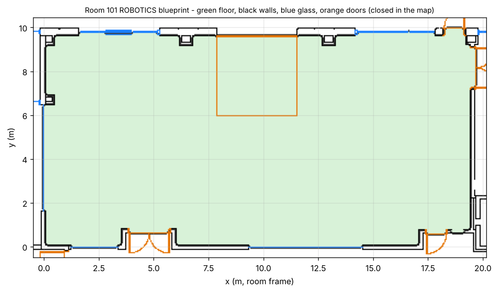

# Connor_Room101 - mapping Room 101

Room 101 is where the APEx station sits. As agreed with the TourBot team, in return for using
their LiDAR mapping tools (see [`../NOTICE.md`](../NOTICE.md)), we map this room with the
TurtleBot 4 and share the map. The finished map lives in [`maps/`](maps/).

## Record the map

Use either method. Both use [`../config/slam.yaml`](../config/slam.yaml).

**A. Station GUI** (laptop runs SLAM; the README's *Mapping the lab with the real TurtleBot*):
open **Drive & Map**, press **Start mapping**, drive the room, and **Save map** as `room101`.
This writes `~/apex_maps/room101.yaml/.pgm/.posegraph/.data`.

**B. SLAM on the robot**, which survives Wi-Fi drops and records a raw bag
([`docs/MAPPING_ON_ROBOT.md`](../../../../docs/MAPPING_ON_ROBOT.md)):

```bash
ros2_ws/src/apex_mapping/tools/map_lab.sh room101                  # TurtleBot 4 controller
ros2_ws/src/apex_mapping/tools/map_lab.sh room101 --no-controller  # drive from the GUI
```

The run is copied to `~/apex_maps/runs/room101/<date_time>/`, and the laptop builds the map again
from the raw lidar data as `rebuilt.pgm` (cleaner than the robot's own `map.pgm`).

How to drive: start at the dock, go slowly, **one loose lap about 1 m from the walls** (so the
map can be lined up with the blueprint), then **everything inside the room** - benches, tables,
the FlexBase, the station - and finish over the start point to close the loop. You do **not**
need to trace the walls or worry about the windows: they come from the CAD blueprint below.

## The blueprint: walls, windows and doors from the building's CAD drawing

[`blueprint/`](blueprint/) holds Room 101 cut out of the building's Level 1 floor plan
(`cad/dxf/Level 1.dxf` in the TourBot repository):



| File | What |
|---|---|
| `room101_blueprint.yaml/.pgm` | map in the **room frame** (x along the long walls, origin at the floor's lower-left corner): floor free, a solid outline along the walls, **glass** (windows, glass doors) and doors (drawn closed), outside unknown |
| `room101_blueprint.json` | room data (ROBOTICS, 1964 SF in the drawing, 182 m² floor found, 19.6 x 9.95 m) and the transforms room frame -> TourBot building frame (rotate 16.00°, shift (1.430, 13.265) m) -> CAD inches |
| `room101_blueprint.png` | picture: black walls, blue glass, orange doors |

Regenerate it (only if the drawing changes) with the TourBot repository cloned next to this one:

```bash
ros2 run apex_bringup cad_blueprint --dxf ~/tourbot/cad/dxf/"Level 1.dxf" --room 101 \
    --out-dir ros2_ws/src/apex_mapping/Connor_Room101/blueprint        # needs: pip install ezdxf
```

## Merge your map into the blueprint

```bash
D=ros2_ws/src/apex_mapping/Connor_Room101
ros2 run apex_bringup blueprint_merge --map ~/apex_maps/room101.yaml \
    --blueprint $D/blueprint/room101_blueprint.yaml --out-dir $D/maps
```

`--map` is `~/apex_maps/room101.yaml` for method A; for method B use the run's rebuilt map,
`~/apex_maps/runs/room101/<date_time>/rebuilt.yaml`.

* Lines the SLAM map up with the CAD walls on its own (every rotation tried, then ICP). If it
  prints a WARNING that another rotation fits almost as well, look at the picture and re-run
  with `--guess tx,ty,deg` (map -> room frame) or `--pairs`.
* Writes into `maps/`:
  * `room101_merged.yaml/.pgm` - **the map to use**: CAD walls / glass / doors + only what your
    map saw **inside** the room, more than 15 cm from the walls. Everything seen through the
    windows or open doors is dropped. Floor the robot never saw stays unknown (`--unseen free`
    to treat it as free).
  * `room101_building.yaml/.pgm` - the same map in **TourBot's building frame** (Central Lobby
    at 0,0) - this is the one to share with the TourBot team.
  * `room101_merge.json` / `room101_merge.png` - the transform, how much of the floor was seen,
    and the picture to check (red CAD outline over your map).
* Paint out anything temporary (a forgotten chair) in white in `room101_merged.pgm`, then commit
  `maps/room101_*` on a branch and open a pull request.

## Align it with lab.yaml, then use it for navigation

The poses, routes and the FlexBase keepout zone are in the `lab.yaml` frame (origin at the
FlexBase centre). Align the map once (details:
[`apex_bringup/README.md`](../../apex_bringup/README.md#aligning-a-real-slam-map-with-labyaml-task-m3)):

```bash
D=$HOME/APEx-2.0/ros2_ws/src/apex_mapping/Connor_Room101/maps
cp $HOME/APEx-2.0/ros2_ws/src/apex_bringup/config/align_pairs_example.yaml $D/room101_pairs.yaml
#   fill in the map: numbers - with the merged map they are ROOM-FRAME coordinates, so a tape
#   measure is enough: metres from the room's (0, 0) corner (lower-left in room101_blueprint.png:
#   where the glass end wall meets the long wall with the two pairs of doors), x along the long
#   wall, y along the end wall. E.g. measure the FlexBase corners (flexbase_ne/nw/sw/se) and the dock.
ros2 run apex_bringup align_map --map $D/room101_merged.yaml --pairs $D/room101_pairs.yaml
#   check room101_merged_alignment.png, then commit room101_merged_lab.*, room101_merged_keepout.*,
#   room101_pairs.yaml, room101_merged_alignment.yaml/.png
ros2 launch apex_bringup robot.launch.py map:=$D/room101_merged_lab.yaml keepout:=true
```

The robot must start on its dock. The tilt tray is off by default (`tilt:=none`); add `tilt:=robot` once it is built and `tilt_platform` runs on the robot.
