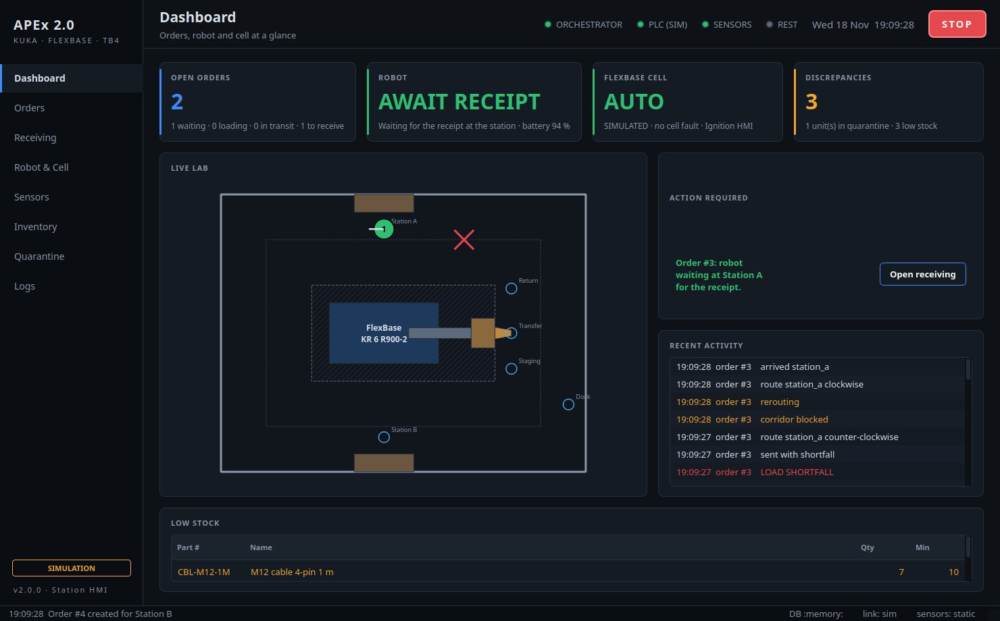

# station - APEx 2.0 main station HMI

**Stage: Station HMI Upgrade.** The operator application for the main station PC:
inventory, multi-part orders, receiving (OK / damaged / missing), quarantine and
discrepancies, a live map of the lab with the TurtleBot, the job state, a **read-only**
FlexBase / KUKA summary, and the operator controls (STOP, Reset, Resume). A REST API serves
the workstation laptop.

It is adapted from the old APEX station (`archive/old_agv/station_gui/`, see
[`docs/AUDIT.md`](../docs/AUDIT.md)): the database, inventory, orders, receiving, the
industrial dark theme, widgets, Qt threading bridge, logs page and REST security are carried
over; the vehicle link, the phone-QR loading flow and the Modbus/PLC servers are replaced by
the job link to the ROS 2 orchestrator.

> **The FlexBase has its own HMI: Ignition.** This station never controls the cell, the KUKA
> or any safety function. It shows a small read-only mirror of the PLC's status tags, and the
> only things it can ask for are jobs and operator decisions - through the orchestrator, which
> asks the PLC, which decides.



---

## 1. Run it

### Any computer - built-in simulation (no ROS)

```bash
cd apex-2.0
python -m pip install -r station/requirements.txt
cd station
python -m apex_station.app                       # Windows: py -m apex_station.app
```

The default `config/station.yaml` uses the **built-in simulation**: the real job state
machine, the real cell simulator (same PLC tags, handshake and fault codes as the FlexBase)
and a simulated TurtleBot run inside the station process, 4x faster than real time. Demo
parts are loaded into an empty database. Everything is labelled **SIMULATION** /
**SIMULATED SAFETY**. The *Robot & Cell* page has a simulation panel to inject cell faults
(lost part, failed pick, no PLC ack, robot not detected) and to block a corridor.

Useful options: `--db /tmp/test.db` (throw-away database), `--no-rest`, `--time-scale 10`.

### With ROS 2 (Gazebo or the real robot)

```bash
# terminal 1 (Ubuntu 24.04 + Jazzy, see docs/SIMULATION.md)
ros2 launch apex_bringup demo.launch.py scenario:=full gazebo:=true   # or sim.launch.py + apex.launch.py
# terminal 2
source ~/apex-2.0/ros2_ws/install/setup.bash
cd ~/apex-2.0/station
python3 -m apex_station.app --link ros
```

In ROS mode the station is a client of `apex_orchestrator` (services `/apex/submit_job`,
`/apex/confirm_receipt`, `/apex/confirm_return`, `/apex/resolve_shortfall`, `/apex/operator`;
topics `/apex/job_status`, `/apex/job_events`) and reads the cell summary from
`apex_plc_bridge` (`/apex/cell_status`, `/apex/arm_status`). It never opens a PLC connection.
Do not run the demo client and the station GUI against the same orchestrator at the same
time - both would answer receipts.

### Live lidar + camera from the real TurtleBot (Sensors page)

```bash
source /opt/ros/jazzy/setup.bash
export ROS_DOMAIN_ID=0 RMW_IMPLEMENTATION=rmw_fastrtps_cpp
. ~/apex-venv/bin/activate                     # venv made with --system-site-packages (sees rclpy)
cd ~/APEx-2.0/station
python -m apex_station.app --sensors ros       # works with the built-in simulation link too
```

The laptop must be on the lab router with the robot on Wi-Fi and undocked - see
[`docs/TURTLEBOT_NETWORK.md`](../docs/TURTLEBOT_NETWORK.md) for setup, the time sync and
troubleshooting. The sensor feed is independent of the job link and needs no orchestrator.

---

## 2. Pages

| Page | What it is for |
|---|---|
| **Dashboard** | KPIs (open orders, robot step + battery, cell mode, open discrepancies), live lab map, **Action required** (everything the job is waiting on a person for, with the buttons), activity feed, low stock |
| **Orders** | *New order*: pick parts (only parts with a PLC part code - i.e. stored in the FlexBase), quantities, destination, priority; stock is reserved at once. *Orders & jobs*: every order with status, job id, lines (ordered / not loaded / OK / damaged / missing) and the full job timeline from the orchestrator; approve / cancel |
| **Receiving** | The worker's condition report at the station: OK + damaged + missing must equal what was **loaded** for each line. Confirming sends the receipt to the orchestrator (the robot may leave) and then books it. A second confirmation asks that hands are out of the bin (RA-10) |
| **Robot & Cell** | Live map, job step with chute count, queue and fault text, **STOP / Reset / Resume**, TurtleBot battery / dock / pose, the read-only FlexBase + KUKA summary, simulation panel (built-in simulation only) |
| **Sensors** | Read-only live view of the real TurtleBot (`--sensors ros`): OAK-D RGB preview and a top-down lidar plot (front up, range rings), with rate, age, **clock offset** (flags a wrong robot clock), point count and nearest obstacle. **Start lidar / Start camera** buttons (the robot stops both on the dock); nothing here moves the robot |
| **Inventory** | Parts master data: slot, **PLC part code** (selects the KRL pick program; 0 = not in the cell), on hand, quarantine, reorder threshold; add / edit / audited stock adjustment / delete; CSV import & export |
| **Quarantine** | Discrepancies - *Damaged*, *Missing* (at delivery), *NotLoaded* (chute short count), *ReturnMismatch* - resolved with a note; not-loaded / missing parts that turn up can be restocked. Quarantine stock (damaged units, never restocked) with disposal |
| **Logs** | Audit log (who, from where - `gui`, `rest:<ip>`, `orchestrator`), job events, live application log |

Screenshots: `docs/img/station_*.png` (regenerate with `QT_QPA_PLATFORM=offscreen python station/tools/screenshots.py`).

---

## 3. How an order flows

```
Pending ─approve─► Approved ─submit─► Queued ─plc_ack─► Loading ─load_complete / shortfall send─► InTransit
   │                  │                  │                 │                                         │
   └──────────────────┴──── cancel ──────┴─────────────────┘                     robot at station ──► Delivered
                                                                                  receipt confirmed ──► Closed
```

StationCore is the **only writer** of the database. It hands approved orders to the
orchestrator (`JobLink.submit`) and books every orchestrator event (`docs/JOB_STATE_MACHINE.md`
section 5):

| Event | Booking |
|---|---|
| order created | stock **reserved** |
| `plc_ack` | order → Loading |
| `load_shortfall` | not-loaded count per line recorded; **Action required: send or cancel** |
| `load_complete` / operator *send* | order → InTransit; not-loaded units → *NotLoaded* discrepancies |
| robot waiting for the receipt (`AWAIT_RECEIPT`) | order → Delivered; **Action required: receipt** |
| receipt | damaged → *Damaged* (return pending), missing → *Missing*; order → Closed |
| robot at the return pose | **Action required: count the return bin**; damaged units → **quarantine**, shortfall → *ReturnMismatch* |
| cancel before loading | reservation released |
| cancel at a shortfall | counted units back to stock, uncounted → *NotLoaded* |
| `fault` | error toast, order shows the fault; **Action required: Reset**, then **Resume** |

People's decisions go to the orchestrator **first** and are booked only when it accepted them,
so the database never says something the robot did not do.

---

## 4. Safety notes

* **STOP is a software stop**, not an emergency stop. It faults the job: the orchestrator
  cancels navigation and tells the PLC (`Job_Fault_Station`). Anyone at risk → the hardware
  E-stop. (Header button, Robot & Cell page, key **F12**.)
* **Reset never restarts motion.** Resume is a separate, deliberate action.
* The cell panel is a **mirror**: values come from `APEX_ToStation` through apex_plc_bridge.
  There is no button, REST endpoint or code path here that writes a PLC tag, a safety value,
  a KUKA mode or an override (a test checks the REST routes).
* In the built-in simulation, `Safety_Simulated` is always true and the page says so in a
  yellow banner. Never take a simulated "Safety OK" for the real thing.
* Risk-assessment items: RA-10 (hands in the bin), RA-17 (two HMIs), RA-19 (software STOP
  mistaken for an E-stop) in [`docs/RISK_ASSESSMENT_POINTS.md`](../docs/RISK_ASSESSMENT_POINTS.md).

---

## 5. REST API (workstation laptop)

FastAPI on `rest.host:rest.port` (default `0.0.0.0:8000`), Swagger UI at `/docs`.
Every endpoint except `/api/health` needs the header `X-API-Key` (`rest.api_key` in
`station.yaml` - **change it**); `rest.allowed_ips` restricts source addresses; every call is
logged with the source IP and every change is audited as `rest:<ip>`.

| Method + path | Purpose |
|---|---|
| `GET /api/health` | liveness (no key) |
| `GET /api/status` | job, robot, read-only cell / KUKA summary |
| `GET /api/kpis`, `GET /api/destinations`, `GET /api/job-events?order_id=` | overview |
| `GET /api/parts`, `GET /api/parts/{part_number}` | inventory |
| `GET/POST /api/orders`, `GET /api/orders/{id}` | list / create / read orders |
| `POST /api/orders/{id}/approve`, `/cancel` | order actions |
| `POST /api/orders/{id}/receive` | receipt `{"lines": [{"line_id", "ok", "damaged", "missing", "notes"}], "receiver"}` |
| `POST /api/orders/{id}/return` | return-bin count `{"count": n}` |
| `POST /api/orders/{id}/shortfall` | `{"action": "send" \| "cancel"}` |
| `GET /api/discrepancies`, `GET /api/discrepancies.csv`, `POST /api/discrepancies/{id}/resolve` | discrepancies |
| `POST /api/operator/{stop\|reset\|resume}` | operator controls |

Example:

```bash
curl -H "X-API-Key: change-me-apex-2" http://station:8000/api/status
curl -H "X-API-Key: change-me-apex-2" -H "Content-Type: application/json" -X POST http://station:8000/api/orders \
     -d '{"requester":"bench 2","destination":"Station B","lines":[{"part_number":"NUT-M8","quantity":4}]}'
```

---

## 6. Configuration (`config/station.yaml`)

| Key | Meaning |
|---|---|
| `station.db_path` | SQLite file (git-ignored `station/data/`) |
| `station.operator` | default name in the audit log |
| `station.auto_approve` | new orders go straight to the job queue |
| `station.seed_demo_data` | load demo parts into an empty database |
| `station.max_lines_per_order` | = PLC array size in `plc_tags.yaml` (10) |
| `station.max_units_per_order` | parts per trip `[TBD]` - bin size / 9 kg payload (Q-S4) |
| `destinations` | display name → pose name in `lab.yaml` |
| `link.mode` | `sim` (built-in simulation) or `ros` |
| `link.sim_time_scale`, `link.ros_timeout_s` | simulation speed, service timeout |
| `sensors.mode` | `"off"` (default) or `"ros"` - live lidar + camera on the Sensors page; quote `"off"` (plain `off` is a YAML boolean) |
| `sensors.scan_topic`, `sensors.image_topic` | `/scan`, `/oakd/rgb/preview/image_raw` |
| `sensors.lidar_start_service`, `sensors.camera_start_service` | `/start_motor` (Empty), `/oakd/start_camera` (Trigger) |
| `sensors.base_frame`, `sensors.lidar_yaw_deg` | robot frame and lidar mount yaw used until `/tf_static` arrives (TurtleBot 4: 90) |
| `rest.*` | enabled, host, port, api_key, allowed_ips |
| `logging.*` | log folder (rotating `station.log`) and level |

---

## 7. Code layout

```
station/
├── apex_station/
│   ├── app.py               entry point (python -m apex_station.app)
│   ├── config.py            station.yaml loader
│   ├── paths.py             makes ros2_ws/src/apex_* importable without ROS
│   ├── core/
│   │   ├── database.py      SQLite schema (parts, orders, lines, discrepancies, audit, job events)
│   │   ├── inventory.py     parts, part codes, quarantine, CSV
│   │   ├── orders.py        order lifecycle + inventory booking rules
│   │   ├── station.py       StationCore: business API, job submission, event booking
│   │   ├── states.py        OrderStatus, PartStatus, DiscrepancyKind
│   │   └── events.py        thread-safe event bus
│   ├── links/
│   │   ├── base.py          JobLink interface + status schema
│   │   ├── local_link.py    built-in simulation (job machine + cell model + kinematic robot)
│   │   └── ros_link.py      ROS 2 client of apex_orchestrator / apex_plc_bridge
│   ├── sensors/
│   │   ├── feed.py          sensor frames, scan geometry, rate meter, "off" + sample feeds (no Qt, no ROS)
│   │   └── ros_feed.py      ROS 2 subscriber for /scan + camera (own rclpy context and thread)
│   ├── net/rest_api.py      FastAPI for the workstation laptop
│   └── ui/                  theme, widgets, bridge, map_view, actions, main_window, pages/*
├── config/station.yaml
├── tests/                   pytest: flow, REST, GUI (offscreen), ROS link (rclpy stand-in)
└── tools/screenshots.py     renders docs/img/station_*.png
```

## 8. Tests

```bash
python -m pytest station/tests -q        # 29 tests, ~10 s; GUI tests run offscreen
```

* `test_station_flow.py` - full order, receipt rules, damaged return to quarantine, shortfall
  send / cancel, cancel rules, fault Reset → Resume, operator STOP, validation, reroute.
* `test_rest_api.py` - API key, IP allow-list, full order over HTTP, no PLC/safety endpoints.
* `test_gui.py` - every page builds; receiving page closes an order; Robot & Cell shows a fault.
* `test_sensors.py` - scan geometry and lidar mount yaw, rate meter, config modes; the Sensors
  page with sample data (live values, wrong-clock warning, no-feed notice, start buttons).
* `test_ros_link.py` - the station's ROS link against the **real** orchestrator and PLC-bridge
  nodes (rclpy stand-in from `ros2_ws/tests/ros_fakes.py`, real cell simulator over TCP).

## 9. Needs testing with ROS / hardware

* `RosJobLink` against a real ROS 2 graph (only tested with the rclpy stand-in so far).
* `RosSensorFeed` (Sensors page) with the real TurtleBot: on 2026-11-18 it received and drew
  real lidar scans (459/720 valid points, clock offset -0.10 s) before the robot dropped off the
  network; the camera view and the Start buttons still need a run with the robot online.
* The station GUI next to Gazebo (`--link ros`) for demos (a)-(c).
* Touch-screen use at the station PC (button sizes), and the workstation laptop over the lab
  network with `rest.allowed_ips` set.
